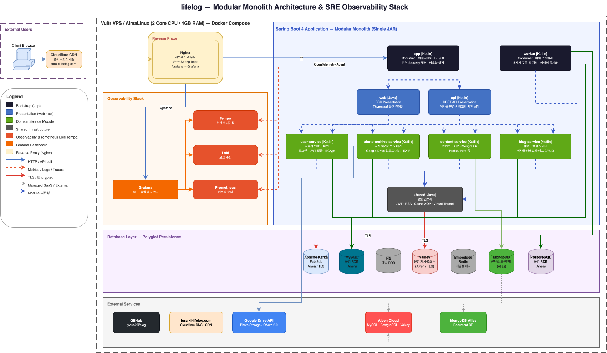

# Lifelog


> 리소스 제약 환경에서 MSA 전환을 고려하여 설계한 Modular Monolith 기반 일상 기록 개인 플랫폼

LIVE SITE : [https://furaiki-lifelog.com](https://furaiki-lifelog.com)

Spring Boot 4.0과 Kotlin/Java를 활용한 풀스택 웹 애플리케이션입니다.
RESTful API 설계, JPA 기반 데이터 모델링, Spring Security 인증을 적용했으며,
**MSA 전환을 고려한 Modular Monolith Architecture**로 설계되었습니다.

아래와 같은 **실무 문제 해결**을 목표로 설계했습니다.

- ❓ MSA를 적용하기 어려운 환경에서는 어떤 아키텍처가 적절한가?
- ❓ 다양한 데이터 특성(정형/비정형/캐시)을 어떻게 분리할 것인가?
- ❓ 운영 환경에서 장애를 어떻게 관측하고 대응할 것인가?

> **Frontend Note**: 프런트엔드(Thymeleaf 템플릿, CSS, JavaScript)는 **Vibe Coding**을 주로 활용하여 개발했습니다.
> 백엔드 아키텍처와 비즈니스 로직에 집중하되, UI/UX 구현은 AI 코딩 어시스턴트와의 협업으로 빠르게 프로토타이핑했습니다.

## 아키텍처 개요

### Modular Monolith을 선택한 이유

이 프로젝트는 포트폴리오 목적으로 클라우드 서버(Vultr, 2 Core CPU / 4GB RAM)에 배포됩니다.
제한된 인프라 스펙에서 다수의 서비스 인스턴스, 서비스 디스커버리, API Gateway 등을 운용하는 MSA를 직접 구현하기 어렵기 때문에,
단일 프로세스로 배포 가능한 Monolithic 구조를 유지하되 **도메인과 기능별로 모듈을 분리**하여 **Modular Monolith Architecture**로 전환했습니다.

이 접근 방식의 장점은 다음과 같습니다.

- **단일 배포 단위**: 하나의 JAR로 빌드·배포되므로 제한된 서버 환경에서도 운용이 가능합니다.
- **모듈 간 경계 명확화**: 각 도메인(사용자, 블로그, 콘텐츠 등)이 독립된 Gradle 모듈로 분리되어 응집도가 높고 결합도가 낮습니다.
- **MSA 전환 용이성**: 모듈 간 의존성이 명시적으로 관리되어, 향후 인프라가 확보되면 개별 모듈을 독립 서비스로 분리할 수 있습니다.
- **빌드 효율성**: 변경된 모듈만 증분 빌드되어 개발 속도가 향상됩니다.

### Lifelog System Architecture



- MSA로 확장 가능한 구조
- 제한된 서버 자원에서의 현실적인 아키텍처 선택
- Observability 기반 운영 환경 구축
- Polyglot Persistence를 통한 데이터 전략 분리

#### Key Features

##### 1. Polyglot Persistence

| 용도        | 기술               |
|-----------|------------------|
| 정형 데이터    | MySQL (JPA, 메인 앱) |
| 비정형 콘텐츠   | MongoDB          |
| 캐시 / 조회수  | Redis (Valkey)   |

👉 데이터 성격에 따라 저장소를 분리하여 확장성과 유연성 확보. 동적 검색·페이징과 조회수 동기화처럼 JPA 로 표현하기 번거로운 쿼리는 동일 MySQL 을 **jOOQ**로 접근합니다.

##### 2. 동적 캐시 전략 (AOP 기반)

- `@DynamicCacheable` 커스텀 어노테이션
- 메서드 단위 캐시 적용
- 캐시별 TTL 동적 설정

👉 단순 캐시가 아닌 **비즈니스 로직 기반 캐시 제어**

##### 3. 고성능 조회수 처리

- Redis `INCR` 기반 원자적 증가
- DB 부하 없이 실시간 집계

##### 4. jOOQ 기반 동적 쿼리

- 조건 기반 검색 (키워드 / 태그 / 카테고리)
- `WITH RECURSIVE` CTE 활용
- 타입 안전 쿼리 구성
- 동적 쿼리 빌더로서의 역할에만 초점을 두어, DSL 구성은 제외

##### 5. Virtual Thread 기반 병렬 처리

- Java 21 Virtual Thread 활용
- 포토 업로드, 게시글 이전/다음 조회 병렬 처리

##### 6. 외부 스토리지 연동 (Google Drive)

- 이미지 업로드 및 서빙, 썸네일 자동 생성
- Google Drive 클라이언트 인스턴스를 요청 범위 내에서 재사용 — 업로드마다 신규 생성하던 `Drive` 객체를 단일 인스턴스로 공유
- 업로드 폴더 경로 Redis 캐시 적용 (`getOrCreateFolderId`, 180분 TTL) — 동일 경로 재업로드 시 Drive API 폴더 탐색 생략
- 이미지 조회 시 파일 확장자로 MIME type 판별 → Drive metadata API 호출 제거 (요청당 Drive 왕복 1회 감소)
- Virtual Thread 병렬 업로드 안전성 확보: `file.bytes`를 사전 로드 후 독립 `ByteArrayInputStream`을 각 스레드에 전달 (스트림 이중 소비 방지)

##### 7. Observability (운영 환경 구성)

- **Prometheus**: 메트릭 수집
- **Loki**: 로그 수집
- **Tempo**: 분산 트레이싱
- **Grafana**: 통합 대시보드

##### 8. 애플리케이션 이벤트 기반 실시간 알림

- AOP(`@AfterReturning`)로 게시글 저장 후 자동 이벤트 발행 (`PostSaveEventAspect`)
- `ApplicationEventPublisher` → `@EventListener` → WebSocket 브로드캐스트
- 발행과 수신이 같은 JVM 안에 있어 메시지 브로커를 두지 않습니다. 발행은 **Virtual Thread** 에서 수행해 요청 스레드를 붙잡지 않습니다
- 브로커가 없으므로 전달 보장은 없습니다. 알림 유실이 게시글 저장에 영향을 주지 않는다는 판단으로 택한 구조입니다

##### 9. 조회수 지연 반영 (스케줄러)

- 게시글 조회 시점에는 Redis `INCR` 만 수행 (`ViewCountHelper`)
- `PostViewCountSyncService` 가 10분마다 Redis → MySQL `posts.view_count` 로 반영
- **jOOQ** 로 발행 글 목록을 읽고, Virtual Thread 로 4건씩 병렬 갱신

##### 10. 사진 좋아요(Like) 및 관리자 삭제

- Cookie 기반 중복 방지 (24시간 쿨다운)
- RFC 6265 호환 쿠키 직렬화 (`photoSeq:timestamp` 형식, `|` 구분자)
- 클라이언트(JavaScript)/서버(`CookieHandler`) 이중 검증
- `GlobalExceptionHandler`로 중복 좋아요 시 400 응답 + 토스트 알림
- **관리자 사진 삭제**: 로그인한 관리자에게만 라이트박스 내 🗑️ 삭제 버튼 노출. Confirm Layer Popup 확인 후 `DELETE /api/photo/delete` 호출로 Soft Delete(`is_active = false`). 삭제 완료 시 라이트박스 자동 닫힘 및 DOM에서 해당 사진 카드 즉시 제거 (페이지 리로드 없음). 삭제 시 `photos` · `activePhotos` Redis 캐시 전체 무효화(`@CacheEvict(allEntries = true)`)

##### 11. 에러 핸들링

- `GlobalExceptionHandler`(`@RestControllerAdvice`): API 예외를 `Rest<T>` 형식으로 일관된 에러 응답
- `CustomErrorController`(`@ControllerAdvice`): 404 페이지 → 5초 후 자동 리다이렉트
- API 경로(`/api`)와 페이지 경로 분리 처리

##### 12. Spring AI × OpenAI — 게시글 요약 자동 생성

- **Spring AI**(`spring-ai-openai`, `ChatClient`)로 OpenAI Chat Completions API 연동
- `shared`에 `OpenAiConfig`(`OpenAiApi`·`OpenAiChatModel`·`ChatClient` Bean), `OpenAiChatService`로 프롬프트 호출 공통화
- `PostFacade.getCreatedSummary()`에서 본문(Markdown 등)을 받아 **3줄 요약** 프롬프트로 변환
- `POST /api/post/create-summary`로 요약 텍스트 반환(`Rest<String>`), Markdown 에디터(`editor.js`)에서 요약 필드에 자동 반영


### 모듈 구조

```
lifelog/
├── app/                        ← 애플리케이션 부트스트랩 (유일한 실행 모듈)
├── web/                        ← SSR 프레젠테이션 계층 (Thymeleaf)
├── api/                        ← REST API 프레젠테이션 계층 (Swagger)
├── user-service/               ← 사용자·인증 도메인
├── blog-service/               ← 블로그(게시글·카테고리·태그) 도메인
├── content-service/            ← 콘텐츠(프로필·차량 소개 등) 도메인
├── photo-archive-service/      ← 사진 아카이브 도메인
├── shared/                     ← 공통 유틸리티·설정
└── sre-containers/             ← SRE 모니터링 스택 (Docker Compose)
```

### 모듈 의존성

```
                         ┌──────────────────┐
                         │       app        │
                         │  (Bootstrap)     │
                         └───────┬──────────┘
                           ┌─────┴─────┐
                           ▼           ▼
                    ┌──────────┐ ┌──────────┐
                    │   web    │ │   api    │
                    │  (SSR)   │ │  (REST)  │
                    └────┬─────┘ └────┬─────┘
                         │            │
          ┌──────────────┼────────────┼──────────────┐
          ▼              ▼            ▼              ▼
  ┌──────────────┐ ┌───────────┐ ┌────────────┐ ┌────────────────────┐
  │ user-service │ │blog-service│ │content-svc │ │photo-archive-svc   │
  │  (사용자)     │ │  (블로그)  │ │ (콘텐츠)   │ │  (사진 아카이브)    │
  └──────┬───────┘ └─────┬─────┘ └─────┬──────┘ └─────────┬──────────┘
         │               │             │                   │
         ▼               ▼             ▼                   ▼
  ┌─────────────────────────────────────────────────────────────────┐
  │                          shared                                 │
  │              (공통 유틸리티·설정·어노테이션)                       │
  └─────────────────────────────────────────────────────────────────┘
```

> 각 도메인 서비스 모듈은 `shared`에만 의존하며, 서비스 모듈 간에는 직접 의존성이 없습니다.
> `web`과 `api`가 모든 서비스 모듈을 조합하여 프레젠테이션 계층에서 오케스트레이션합니다.
> `bootJar`를 만드는 모듈은 `app` 하나이며, 나머지는 라이브러리 jar 로 그 안에 포함됩니다.

### 각 모듈의 역할

| 모듈 | 유형 | 역할 |
|------|------|------|
| **app** | Bootstrap | Spring Boot 애플리케이션 진입점. 전역 Security 필터 설정, `bootJar`를 생성하는 유일한 실행 모듈. `web`과 `api`만 의존 |
| **web** | Presentation | Thymeleaf 기반 SSR 컨트롤러. 메인 페이지, 게시글 뷰, 에디터, 프로필, 사진 갤러리, 아키텍처 등 화면 렌더링. `CustomErrorController`로 404 에러 핸들링 (API/페이지 분리, 5초 리다이렉트) |
| **api** | Presentation | REST API 컨트롤러. `AuthController`는 `user-service`의 `AuthFacade`·`AuthService`를 호출. 게시글 CRUD/검색, **AI 요약 생성**(`POST /api/post/create-summary`), 인증(RSA 공개키·로그인·토큰 갱신), 카테고리 조회, 사진 좋아요·**관리자 삭제(`DELETE /api/photo/delete`)** API. `GlobalExceptionHandler`로 API 예외를 `Rest<T>` 일관 응답, `CookieHandler`로 좋아요 쿠키 검증. Swagger UI 문서화 |
| **user-service** | Domain | 사용자 엔티티·인증. **`AuthFacade`**(`@Facade`), `AuthService`(로그인·JWT·**Refresh Token**), `RefreshTokenRepository`(Redis 저장·TTL), `UserDetailsService`, BCrypt, **세션 + Access/Refresh JWT**(토큰 갱신 API). JPA `User` 엔티티 — RefreshToken은 **RDB 테이블 제거 후 Redis 전용** |
| **blog-service** | Domain | 블로그 핵심 도메인. 게시글·카테고리·태그 CRUD, jOOQ 동적 검색·페이징(재귀 CTE로 하위 카테고리 포함 검색), jOOQ bulk insert 태그 저장, MapStruct DTO 변환(default 메서드로 변환 로직 분리). `PostFacade`에서 Spring AI 연동 `OpenAiChatService`를 통한 **게시글 본문 기반 요약문 생성**. `PostSaveEventAspect`가 저장 후 `PostUpdatedEvent` 발행, `PostViewCountSyncService`가 Redis 조회수를 MySQL 로 주기 동기화 |
| **content-service** | Domain | MongoDB Document 기반 콘텐츠 관리. 자기소개(PROFILE), 애차 소개(CAR) 등 타입별 콘텐츠 저장·조회 |
| **photo-archive-service** | Domain | 사진 아카이브 도메인. Google Drive 연동 이미지 업로드·서빙, 썸네일 자동 생성, EXIF 메타데이터 저장, jOOQ 동적 검색, PhotoArchiveFacade |
| **shared** | Infrastructure | 공통 유틸리티. JWT 토큰 핸들러, RSA 키 관리, Markdown 변환기, Google Drive 설정/헬퍼, **Spring AI(OpenAI ChatClient)** 설정(`OpenAiConfig`)·호출 서비스(`OpenAiChatService`), jOOQ 공통 설정, AsyncSupporter, PageResponse, @Facade, @DynamicCacheable, ViewCountHelper, Redis 캐시 설정, 게시글 갱신 이벤트 DTO(`PostUpdatedEvent`), 공통 예외 |
| **sre-containers** | DevOps | Docker Compose 기반 SRE 모니터링 스택. Grafana(대시보드)·Prometheus(메트릭)·Loki(로그)·Tempo(트레이싱) 컨테이너를 한 번에 실행하여 애플리케이션 Observability 확보 |

## 주요 기능

- **게시글 관리**: CRUD 및 ID/Slug 기반 조회, Markdown 원본 보존
- **AI 요약(Spring AI + OpenAI)**: 게시글 본문을 기반으로 OpenAI Chat API를 호출해 **간결한 3줄 요약**을 생성하고, 에디터에서 요약(summary) 입력란에 바로 넣을 수 있음(`POST /api/post/create-summary`, Swagger 문서화)
- **게시글 검색·페이징**: jOOQ 기반 동적 쿼리로 키워드·카테고리·태그·상태 필터링 및 페이징 조회. 카테고리 검색 시 `WITH RECURSIVE` CTE로 하위 카테고리 게시글까지 포함 조회
- **Markdown 에디터**: Commonmark 기반 Markdown → HTML 변환, 에디터 UI에서 카테고리·태그 입력 지원, 게시일자 직접 지정 가능
- **관리자 인증**: Spring Security + 세션/JWT 이중 인증, BCrypt, RSA 비밀번호 암호화. **Access Token**·**Refresh Token** 발급, 토큰 갱신 API. Refresh Token은 **Redis**에 저장(TTL 만료) — JPA `RefreshToken` 엔티티 제거. `AuthFacade`·`AuthService`는 **`user-service`**에 위치하고, `api`의 `AuthController`가 이를 호출
- **카테고리 시스템**: 계층 구조(Self-referencing) 카테고리, 최대 3 depth 트리 조회, 인덱스 페이지 동적 카테고리 렌더링
- **태그 시스템**: 게시글에 태그를 부여하는 다대다(M:N) 관계, 태그 클릭 시 해당 태그 검색 결과 링크, 검색 결과에서 현재 태그 bold 하이라이팅, jOOQ bulk insert로 태그 일괄 저장
- **콘텐츠 관리**: MongoDB Document 기반 유연한 콘텐츠 저장 (자기소개, 애차 소개 등)
- **사진 아카이브**: Google Drive 연동 이미지 업로드·서빙, 600px 썸네일 자동 생성, 클라이언트 EXIF 추출(exifr) 및 서버 메타데이터 저장, jOOQ 동적 검색·페이징, 카테고리별 분류, Valkey/Redis 캐시로 Drive API 호출 최소화, 모바일/태블릿 라이트박스 UX 최적화(캡션/태그 상시 표시, 메타정보 토글, 세로 사진 전체 표시)
- **사진 좋아요(Like) 시스템**: Cookie 기반 중복 방지 좋아요 기능. 24시간 쿨다운, RFC 6265 호환 쿠키 직렬화(`|` 구분자), 클라이언트/서버 이중 검증, 토스트 알림 UX
- **관리자 사진 삭제**: 로그인한 관리자만 라이트박스 내 🗑️ 버튼으로 사진 삭제 가능. Confirm 팝업 → `DELETE /api/photo/delete` 호출 → `is_active = false` Soft Delete. 삭제 완료 후 DOM 카드 즉시 제거(페이지 리로드 없음), `photos`·`activePhotos` 캐시 전체 무효화
- **Valkey/Redis 캐시 확대 적용**: Google Drive 폴더/파일 ID 캐싱뿐 아니라, 블로그 카테고리 트리(15분 TTL), MongoDB 콘텐츠(5분 TTL), **게시글 단건 조회(본문·태그 등, 24시간 TTL)** , 이미지·프록시 응답 **캐시 정책(예: 7일)** , 블로그 게시글 조회수까지 Valkey/Redis를 활용. `@DynamicCacheable` + `@Aspect`로 메서드 단위 캐시, 캐시 Evict 시 **null 방어** 처리. `DynamicRedisCacheManager`로 캐시별 TTL 동적 관리
- **블로그 게시글 조회수 관리**: Valkey/Redis의 `INCR` 커맨드로 게시글 조회수를 원자적으로 관리. RDB 부하 없이 실시간 조회수 집계, 서버 재시작 시에도 조회수 유지. 인덱스 페이지 및 게시글 목록에서 조회수 표시
- **관리자 전용 보안**: Spring Security로 에디터·업로드·Google Auth 경로 인증 보호, 비인가 접근 시 access-denied 페이지, 세션 기반 로그아웃
- **에러 핸들링**: `GlobalExceptionHandler`(`@RestControllerAdvice`)로 API 예외를 `Rest<T>` 형식의 일관된 에러 응답으로 처리, `CustomErrorController`(`@ControllerAdvice`)로 404 Not Found 시 안내 페이지 렌더링 및 5초 후 자동 리다이렉트
- **SSR 페이지**: Thymeleaf 템플릿 기반 서버 사이드 렌더링
- **레이아웃 데코레이터 패턴**: Thymeleaf Layout Dialect로 공통 nav/footer 분리
- **반응형 UI**: 네비게이션, 푸터 포함 모바일/데스크톱 대응
- **Facade 패턴**: Controller → Facade → Service 구조로 비즈니스 오케스트레이션 분리 (PostFacade, AuthFacade, PhotoArchiveFacade)
- **Virtual Thread**: Java 21 Virtual Thread로 비동기 병렬 처리 (`AsyncSupporter` 공통 유틸리티). **이전/다음 게시글**은 **`publishedAt`(발행 시각) 기준**으로 조회, 게시글+태그 저장·업로드 병렬화 등에 활용
- **Polyglot Persistence**: RDB(MySQL/H2), MongoDB, Valkey/Redis를 함께 사용하는 다중 데이터 소스 구성
- **DB 접속 정보 암호화**: Jasypt(PBEWithMD5AndDES)로 MySQL·MongoDB·Redis 접속 정보 암호화
- **Observability**: Prometheus 메트릭 수집, Loki 로그 수집, OpenTelemetry 분산 트레이싱, Logback 프로파일별 로깅 전략
- **공통 API 응답 형식**: `Rest<T>` 제네릭 래퍼로 일관된 JSON 응답 구조
- **인프로세스 이벤트 아키텍처**: `PostSaveEventAspect`가 저장 직후 **`PostUpdatedEvent`** 를 `ApplicationEventPublisher` 로 발행(`JoinPoint` 인자를 직접 써 DB 재조회 제거). `web` 의 `@EventListener` 가 받아 WebSocket 으로 브로드캐스트. 발행자와 수신자가 같은 JVM 이라 브로커를 두지 않습니다
- **지연 쓰기 스케줄러**: 조회수는 Redis `INCR` 로만 받고, `PostViewCountSyncService`(`@Scheduled`)가 10분마다 **jOOQ** 로 MySQL `posts.view_count` 에 반영. 조회 요청마다 RDB 를 쓰지 않습니다
- **API 문서화**: Swagger UI 자동 생성

## 기술 스택

| 구분 | 기술 |
|------|------|
| **Language** | Kotlin 2.2.21, Java 21 |
| **Framework** | Spring Boot 4.0.2 |
| **Architecture** | Multi-Module Modular Monolith (Gradle) |
| **Security** | Spring Security (세션 + JWT 이중 인증, BCrypt, RSA 비밀번호 암호화) |
| **JWT** | JJWT 0.12.6 (Access Token 생성/검증, HMAC-SHA256 서명) |
| **ORM** | Spring Data JPA, Hibernate |
| **Query Builder** | jOOQ (blog-service: 동적 검색·페이징·조회수 동기화, photo-archive-service: 동적 검색) |
| **Document DB** | MongoDB (콘텐츠 도큐먼트 저장, Spring Data MongoDB) |
| **Cache** | Valkey/Redis (Spring Data Redis, Spring Cache 추상화, `@DynamicCacheable` + `@Aspect` AOP, `DynamicRedisCacheManager`, `RedisSerializer.json()`, 역직렬화 실패 자동 복구) |
| **Template Engine** | Thymeleaf (SSR) + Thymeleaf Layout Dialect (Decorator Pattern) |
| **Client Libraries** | Vanilla JS, Prism.js (코드 하이라이팅), exifr (클라이언트 EXIF 추출) |
| **Markdown** | Commonmark 0.24.0 (GFM Tables, Strikethrough, Autolink, Heading Anchor, Task List) |
| **Database** | H2 (개발 RDB), MySQL (운영 RDB), MongoDB (콘텐츠 도큐먼트), Valkey/Redis (캐시·조회수) |
| **Build Tool** | Gradle 9.3.0 (Kotlin DSL, Multi-Module) |
| **API Documentation** | Springdoc OpenAPI 3.0.3 (Swagger, Spring Boot 4 대응 라인) |
| **Object Mapping** | MapStruct 1.6.3 |
| **External Storage** | Google Drive API v3 (OAuth 2.0, 이미지 업로드·서빙·썸네일 생성) |
| **Concurrency** | Java 21 Virtual Thread, AsyncSupporter (CompletableFuture 래퍼) |
| **Eventing** | Spring `ApplicationEventPublisher` / `@EventListener` (인프로세스, 브로커 없음) |
| **Scheduling** | Spring `@Scheduled` (`@EnableScheduling`, 조회수 동기화 cron) |
| **AI / LLM** | Spring AI 2.0.0-M3 (`spring-ai-openai`, `spring-ai-starter-model-openai`), OpenAI Chat Completions API (`ChatClient`, `OpenAiChatModel`) |
| **Encryption** | Jasypt 3.0.5 (PBEWithMD5AndDES, DB 접속 정보 암호화) |
| **Observability** | Micrometer Prometheus (메트릭), Loki4j (로그 수집), OpenTelemetry (분산 트레이싱) |
| **Logging** | Logback (프로파일별 전략: 콘솔/파일/Loki, 에러 로그 분리, 30일 보관) |
| **Monitoring** | Spring Boot Actuator (health, info, prometheus, metrics) |

## 레이어드 아키텍처

각 모듈은 레이어드 아키텍처를 따르며, 모듈 간 통신은 직접 메서드 호출로 이루어집니다.

```
┌─────────────────────────────────────────────────────────────────────────────┐
│                         Presentation Layer                                  │
│                                                                             │
│  ┌─ web module ──────────────────────┐  ┌─ api module ────────────────────┐ │
│  │ RenderingController  (SSR Pages)  │  │ PostController     (REST API)  │ │
│  │ ContentController    (SSR Pages)  │  │ AuthController     (REST API)  │ │
│  │ PostViewController   (SSR Editor) │  │ PhotoController    (REST API)  │ │
│  │ CustomErrorController (404)       │  │ GlobalExceptionHandler         │ │
│  └───────────────────────────────────┘  │ CookieHandler, SwaggerConfig   │ │
│                                         │ Rest<T> (Auth는 user-service     │ │
│                                         │  AuthFacade 연동)                │ │
│                                         └────────────────────────────────┘ │
└──────────────┬──────────────────────────────────────┬──────────────────────┘
               │                                      │
┌──────────────┼──────────────────────────────────────┼──────────────────────┐
│              ▼              Facade Layer             ▼                      │
│  ┌─ blog-service ─────────────────────────────────────────────────────┐    │
│  │  PostFacade (@Facade)                                              │    │
│  │  - 게시글 조회·저장 오케스트레이션                                    │    │
│  │  - 에디터 데이터 조합 (카테고리 + 게시글 + 태그)                     │    │
│  │  - Virtual Thread로 이전/다음 글 병렬 조회                          │    │
│  │  - Spring AI(OpenAiChatService)로 본문 요약문 생성                  │    │
│  └────────────────────────────────────────────────────────────────────┘    │
└───────────────────────────────────────────────────────────────────────────-┘
               │
┌──────────────┼────────────────────────────────────────────────────────────-┐
│              ▼              Business Layer (Domain Modules)                 │
│                                                                             │
│  ┌─ blog-service ────────────┐  ┌─ user-service ───────┐  ┌─ content-service ──┐ │
│  │ PostService         (CRUD) │  │ AuthFacade (@Facade) │  │ ContentService     │ │
│  │ CategoryService            │  │ AuthService (JWT·     │  │  (MongoDB 콘텐츠)  │ │
│  │ PostTagService             │  │  RefreshToken·Redis) │  │ MongoConfig        │ │
│  │ PostsQueryRepository(jOOQ) │  │ UserService,         │  └────────────────────┘ │
│  │ PostTagsQueryRepository    │  │ CustomUserDetails,    │                         │
│  │ PostMapper, CategoryMapper │  │ SecurityConfig,       │                         │
│  └────────────────────────────┘  │ UserMapper            │                         │
│                                  └──────────────────────┘                          │
│                                                                                    │
│  ┌─ photo-archive-service ──────────────────────────────────────────────────────┐ │
│  │ PhotoArchiveFacade (@Facade) │ GoogleDriveService │ PhotoService             │ │
│  │ PhotosQueryRepository (jOOQ) │ PhotoMapper, PhotoCategoryMapper             │ │
│  └──────────────────────────────────────────────────────────────────────────────┘ │
│                                                                                    │
│  ┌─ shared ─────────────────────────────────────────────────────────────────────┐ │
│  │ AccessTokenHandler (JWT)  │ RsaKeyHolder (RSA)    │ GoogleDriveConfig/Helper │ │
│  │ MarkdownConverter (MD→HTML) │ AsyncSupporter │ JooqConfig │ PageResponse     │ │
│  │ VirtualThreadConfig │ @Facade │ @DynamicCacheable │ ViewCountHelper          │ │
│  │ RedisCacheConfig │ DynamicCacheableInterceptor (@Aspect) │ DynamicRedisCacheManager │ │
│  │ JacksonConfig │ OpenAiConfig · OpenAiChatService │ PostUpdatedEvent          │ │
│  └───────────────────────────────────────────────────────────────────────────────┘ │
└───────────────────────────────────────────────────────────────────────────-┘
               │
┌──────────────┼────────────────────────────────────────────────────────────-┐
│              ▼        Event / Scheduling Layer (인프로세스)                 │
│                                                                             │
│  ┌─ blog-service (Publisher) ───────────────────────────────────────────┐  │
│  │ PostSaveEventAspect (@AfterReturning)                                │  │
│  │ → PostFacade.savePost() 후 PostUpdatedEvent 발행 (Virtual Thread)    │  │
│  └──────────────────────────────┬───────────────────────────────────────┘  │
│                                 │  ApplicationEventPublisher (같은 JVM)     │
│  ┌─ web (Listener) ──────────────┼───────────────────────────────────────┐  │
│  │ PostPublishedNotificationListener (@EventListener)                    │  │
│  │ → PUBLISHED 만 통과 → NotificationBroadcastService → WebSocket        │  │
│  └────────────────────────────────────────────────────────────────────────┘  │
│                                                                             │
│  ┌─ blog-service (Scheduler) ─────────────────────────────────────────────┐  │
│  │ PostViewCountSyncService (@Scheduled, 10분 주기)                       │  │
│  │ → ViewCountHelper(Redis) 읽어 PostsQueryRepository(jOOQ)로 MySQL 반영  │  │
│  └────────────────────────────────────────────────────────────────────────┘  │
└───────────────────────────────────────────────────────────────────────────-┘
               │
┌──────────────┼────────────────────────────────────────────────────────────-┐
│              ▼              Data Access Layer                               │
│  ┌────────────────────┐  ┌──────────────────────┐  ┌──────────────────────┐ │
│  │PostsRepository     │  │UserRepository        │  │ContentDocumentRepo   │ │
│  │PostTagsRepository  │  │                      │  │ (MongoRepository)    │ │
│  │CategoriesRepository│  │                      │  │                      │ │
│  └────────┬───────────┘  └────────┬─────────────┘  └────────┬─────────────┘ │
└───────────┼───────────────────────┼──────────────────────────┼──────────────┘
            │                       │                          │
┌───────────┼───────────────────────┼──────────────────────────┼──────────────┐
│           ▼                       ▼                          ▼              │
│                             Database Layer                                       │
│  ┌────────────────────────────┐ ┌───────────────────┐ ┌───────────────────────┐ │
│  │ H2 (개발) / MySQL (운영)  │ │     MongoDB       │ │ Embedded Redis (개발) │ │
│  │ users, posts, categories, │ │ content-documents  │ │ Valkey SaaS (운영)    │ │
│  │ posts_tags, photos, ...   │ │                    │ │ 캐시, 조회수 관리     │ │
│  └────────────────────────────┘ └───────────────────┘ └───────────────────────┘ │
└─────────────────────────────────────────────────────────────────────────────────┘

┌─────────────────────────────────────────────────────────────────────────────┐
│                        Template Layer (Thymeleaf)                            │
│  ┌──────────────┐  ┌─────────────────┐  ┌──────────────────────────────┐   │
│  │layout/       │  │fragments/       │  │ Pages                        │   │
│  │ default.html │  │ navigation.html │  │ index, profile, post,        │   │
│  │ (base layout │◄─┤ footer.html     │  │ post-list, my-car, photos,   │   │
│  │  + 로그인 모달)│  └─────────────────┘  │ sre, architecture,           │   │
│  └──────────────┘                        │ not-found, access-denied     │   │
│                                          │ (layout:decorate 적용)       │   │
│                                          ├──────────────────────────────┤   │
│                                          │ editor, photo-upload         │   │
│                                          │ (독립 Standalone)            │   │
│                                          └──────────────────────────────┘   │
└─────────────────────────────────────────────────────────────────────────────┘
```

## 프로젝트 구조

```
lifelog/
├── build.gradle.kts                   # 루트: 플러그인 버전 관리 + subprojects 공통 설정
├── settings.gradle.kts                # 모듈 include 선언
│
├── app/                               # [Bootstrap Module]
│   ├── src/main/kotlin/
│   │   └── com/walter/lifelog/
│   │       ├── LifelogApplication.kt  #   Spring Boot 메인 클래스
│   │       └── config/
│   │           ├── FilterConfig.kt        #   전역 Security 필터 (인증 경로 보호, 로그아웃)
│   │           └── JasyptConfig.kt        #   Jasypt DB 접속 정보 암호화 설정
│   └── src/main/resources/
│       ├── application.yml            #   기본(H2+MongoDB+EmbeddedRedis) 프로필 설정
│       ├── application-live.yml       #   운영(MySQL+MongoDB+Valkey) 프로필 설정
│       └── logback-spring.xml         #   프로파일별 로깅 (콘솔/파일/Loki)
│
├── web/                               # [Web Presentation Module]
│   └── src/main/java/
│       └── com/walter/lifelog/web/
│           ├── controller/
│           │   ├── ContentController.java         # 콘텐츠 SSR (profile, my-car, access-denied)
│           │   ├── CustomErrorController.java     # 404 에러 핸들링 (API/페이지 분리, 5초 리다이렉트)
│           │   ├── GoogleAuthController.java      # Google OAuth 2.0 인증 콜백
│           │   ├── PhotoArchiveController.java    # 사진 갤러리·업로드 SSR
│           │   ├── PhotoViewController.java       # Google Drive 이미지 서빙
│           │   ├── PostViewController.java        # 게시글 상세·에디터·목록 SSR
│           │   └── SreViewController.java         # SRE 대시보드 SSR
│           └── util/
│               └── RedirectUrlBuilder.java        # 리다이렉트 URL 생성 유틸
│
├── api/                               # [API Presentation Module]
│   └── src/main/kotlin/
│       └── com/walter/lifelog/api/
│           ├── config/
│           │   ├── SwaggerConfig.kt       # OpenAPI/Swagger 설정
│           │   └── GlobalExceptionHandler.kt  # @RestControllerAdvice 글로벌 예외 핸들링
│           ├── controller/
│           │   ├── AuthController.kt      # 인증 REST API (로그인, RSA 공개키)
│           │   ├── PostController.kt      # 게시글 REST API (조회, 검색, 저장, AI 요약, 카테고리 트리)
│           │   ├── PhotoController.kt     # 사진 REST API (조회, 업로드, 카테고리, 좋아요, 관리자 삭제)
│           │   └── dto/
│           │       ├── Rest.kt            # 공통 API 응답 래퍼
│           │       └── PublicKeyResponse.kt  # RSA 공개키 응답 DTO
│           └── util/
│               └── CookieHandler.kt      # 사진 좋아요 쿠키 검증 (24시간 쿨다운, RFC 6265)
│
├── user-service/                      # [User Domain Module]
│   └── src/main/kotlin/
│       └── com/walter/lifelog/user/
│           ├── config/
│           │   └── SecurityConfig.kt      # AuthenticationManager, BCrypt 설정
│           ├── entity/
│           │   └── User.kt               # 사용자 엔티티
│           ├── dto/
│           │   ├── LoginRequest.kt
│           │   ├── LoginResponse.kt      # accessToken, refreshToken(필요 시)
│           │   ├── LoginStatusResponse.kt
│           │   └── Author.kt
│           ├── facade/
│           │   └── AuthFacade.kt          # 인증 오케스트레이션 (@Facade) — api의 AuthController가 사용
│           ├── mapper/
│           │   └── UserMapper.kt          # MapStruct: User → Author 변환
│           ├── repository/
│           │   ├── UserRepository.kt
│           │   └── RefreshTokenRepository.kt  # Redis String — Refresh Token 저장·검증·TTL
│           └── service/
│               ├── AuthService.kt             # 로그인, JWT·RefreshToken 발급/갱신/폐기
│               ├── CustomUserDetailsService.kt # Spring Security UserDetails
│               └── UserService.kt             # 사용자 조회
│
├── blog-service/                      # [Blog Domain Module]
│   └── src/main/kotlin/
│       └── com/walter/lifelog/blog/
│           ├── entity/
│           │   ├── Post.kt                # 게시글 엔티티
│           │   ├── Category.kt            # 카테고리 엔티티 (계층 구조)
│           │   ├── PostTag.kt             # 게시글-태그 M:N 엔티티
│           │   └── code/
│           │       └── PostStatus.kt      # DRAFT / PUBLISHED / ARCHIVED
│           ├── dto/
│           │   ├── PostRequest.kt
│           │   ├── PostResponse.kt
│           │   ├── PostSaveResponse.kt
│           │   ├── PostListResponse.kt    # 게시글 목록 DTO
│           │   ├── PostSearchCondition.kt # 검색 조건 (키워드, 카테고리, 태그, 상태, 페이징)
│           │   ├── PageResponse.kt        # 페이징 응답 래퍼
│           │   ├── PostCategory.kt
│           │   └── CategoryTreeResponse.kt
│           ├── facade/
│           │   └── PostFacade.kt          # 비즈니스 오케스트레이션 (@Facade)
│           ├── event/
│           │   └── PostSaveEventAspect.kt # @AfterReturning: 저장 후 PostUpdatedEvent 발행
│           ├── mapper/
│           │   ├── PostMapper.kt          # MapStruct: Post ↔ DTO
│           │   └── CategoryMapper.kt      # MapStruct: Category → DTO
│           ├── repository/
│           │   ├── PostsRepository.kt     # JPA Repository
│           │   ├── PostsQueryRepository.kt  # jOOQ 동적 쿼리 (검색·페이징, 재귀 CTE 카테고리)
│           │   ├── PostTagsQueryRepository.kt # jOOQ 태그 bulk insert·삭제
│           │   ├── CategoriesRepository.kt
│           │   └── PostTagsRepository.kt
│           └── service/
│               ├── PostService.kt         # 게시글 CRUD
│               ├── CategoryService.kt     # 카테고리 트리 조회
│               └── PostTagService.kt      # 태그 관리
│
├── content-service/                   # [Content Domain Module — MongoDB]
│   └── src/main/kotlin/
│       └── com/walter/lifelog/content/
│           ├── config/
│           │   └── MongoConfig.kt         # MongoDB Auditing 설정
│           ├── entity/
│           │   ├── ContentDocuments.kt    # MongoDB Document 엔티티
│           │   └── code/
│           │       └── ContentType.kt     # INTRO / PROFILE / CAR
│           ├── repository/
│           │   └── ContentDocumentRepository.kt  # MongoRepository
│           └── service/
│               └── ContentService.kt      # 타입별 콘텐츠 조회
│
├── photo-archive-service/             # [Photo Archive Domain Module]
│   └── src/main/kotlin/
│       └── com/walter/lifelog/photo/
│           ├── entity/
│           │   ├── Photo.kt               # 사진 엔티티 (EXIF, GPS, 썸네일 등)
│           │   ├── PhotoCategory.kt       # 사진 카테고리 엔티티
│           │   └── PhotoTag.kt            # 사진-태그 M:N 엔티티
│           ├── dto/
│           │   ├── UploadRequest.kt       # 업로드 요청 (메타데이터 + EXIF)
│           │   ├── UploadResponse.kt      # 업로드 결과 (Drive 경로·링크)
│           │   ├── PhotoSearchRequest.kt  # 사진 검색 요청 (카테고리, 페이징)
│           │   ├── PhotoSearchResponse.kt # 사진 검색 결과 (EXIF, 촬영자 등)
│           │   ├── PhotoCategoryResponse.kt # 카테고리 응답
│           │   ├── PhotoLikeCountResponse.kt # 좋아요 수 응답
│           │   ├── ExifInfo.kt            # EXIF 정보 DTO
│           │   └── ImageResource.kt       # 이미지 리소스 (InputStream + MIME)
│           ├── facade/
│           │   └── PhotoArchiveFacade.kt  # 사진 업로드·조회 오케스트레이션 (@Facade)
│           ├── mapper/
│           │   ├── PhotoMapper.kt         # MapStruct: UploadRequest → Photo
│           │   └── PhotoCategoryMapper.kt # MapStruct: PhotoCategory → DTO
│           ├── repository/
│           │   ├── PhotosRepository.kt    # JPA Repository
│           │   ├── PostsQueryRepository.kt  # jOOQ 동적 쿼리 (검색·페이징, 재귀 CTE 카테고리)
│           │   ├── PhotoCategoriesRepository.kt
│           │   └── PhotoTagsRepository.kt
│           └── service/
│               ├── GoogleDriveService.kt  # Google Drive 업로드·이미지 서빙
│               └── PhotoService.kt        # 사진 검색·카테고리 조회
│
└── shared/                            # [Shared Infrastructure Module]
    ├── src/main/java/
    │   └── com/walter/lifelog/shared/
    │       ├── annotation/
    │       │   ├── Facade.java            # @Facade 커스텀 어노테이션
    │       │   └── DynamicCacheable.java  # @DynamicCacheable 캐시 어노테이션 (value, key, ttlMinutes)
    │       ├── config/
    │       │   ├── VirtualThreadConfig.java   # Virtual Thread TaskExecutor
    │       │   ├── EmbeddedRedisConfig.java   # 비운영 프로필 Embedded Redis (@Profile("!live"))
    │       │   ├── GoogleDriveConfig.java     # Google Drive OAuth 2.0 설정
    │       │   ├── JooqConfig.java            # jOOQ 공통 설정 (실행 로깅, 포매팅)
    │       │   ├── RedisCacheConfig.java      # Redis 캐시 매니저 설정
    │       │   ├── cache/
    │       │   │   ├── DynamicCacheableInterceptor.java  # @Aspect 기반 캐시 AOP (@Around)
    │       │   │   ├── DynamicRedisCacheManager.java     # 캐시별 TTL 동적 할당 CacheManager
    │       │   │   ├── DynamicCacheRegistry.java         # 캐시명-TTL 레지스트리
    │       │   │   └── DynamicCacheableScanner.java      # Bean 초기화 시 캐시 메타 스캔
    │       │   ├── JacksonConfig.java             # ObjectMapper Bean (JavaTimeModule)
    │       │   ├── OpenAiConfig.java              # OpenAiApi / OpenAiChatModel / ChatClient Bean
    │       │   └── exception/
    │       │       └── PostNotFoundException.java
    │       ├── event/
    │       │   └── PostUpdatedEvent.java      # 게시글 저장 후 애플리케이션 이벤트 페이로드 (record)
    │       ├── paging/
    │       │   └── PageResponse.java          # 공통 페이징 응답 DTO (record)
    │       ├── service/
    │       │   ├── OpenAiChatService.java    # ChatClient 기반 OpenAI 호출
    │       │   └── dto/
    │       │       └── AiChatRequest.java     # system/user 메시지 DTO
    │       └── util/
    │           ├── AccessTokenHandler.java    # JWT 토큰 생성/검증
    │           ├── RsaKeyHolder.java          # RSA 2048 키 쌍 관리·암복호화
    │           ├── MarkdownConverter.java      # Markdown → HTML 변환
    │           ├── GoogleDriveHelper.java     # Google Drive 파일 업로드·조회·썸네일 생성
    │           ├── AsyncSupporter.java        # CompletableFuture 비동기 래퍼
    │           └── ViewCountHelper.java       # Redis INCR 증가 / 현재값 조회
    └── src/main/resources/
        └── credential.json            # Google Drive OAuth 2.0 인증 정보 (.gitignore)

sre-containers/                        # SRE 모니터링 스택 (Docker Compose)
├── docker-compose.yml                 # Grafana + Prometheus + Loki + Tempo 컨테이너 정의
├── prometheus/
│   └── config/prometheus.yml          # Prometheus 스크래핑 설정 (lifelog /actuator/prometheus, 5초 주기)
├── loki/
│   └── config/loki-config.yml         # Loki 로그 수집·저장 설정 (TSDB, 24h 인덱스 주기)
└── tempo/
    └── etc/tempo.yaml                 # Tempo 분산 트레이싱 설정 (OTLP/Jaeger/Zipkin 수신)
```

## 데이터베이스 스키마

### ERD (Entity Relationship Diagram)

```
┌─────────────────────┐       ┌─────────────────────┐       ┌─────────────────────┐
│       users         │       │        posts        │       │     categories      │
├─────────────────────┤       ├─────────────────────┤       ├─────────────────────┤
│ PK  user_seq        │◄──────│ FK  user_seq        │       │ PK  category_seq    │
│     email        UQ │       │ FK  category_seq    │──────►│     category_name UQ│
│     name         UQ │       │ PK  post_seq        │       │     slug         UQ │
│     password_hash   │       │     title           │       │     description     │
│     display_name    │       │     slug         UQ │       │ FK  parent_category │──┐
│     bio             │       │     summary         │       │     display_order   │  │
│     profile_image   │       │     content         │       │     is_active       │  │
│     github_url      │       │     markdown_content│       │     created_at      │  │
│     linkedin_url    │       │     thumbnail_url   │       │     updated_at      │  │
│     is_active       │       │     status (ENUM)   │       └─────────────────────┘  │
│     created_at      │       │     view_count      │              ▲                 │
│     updated_at      │       │     published_at    │              │ Self-reference  │
└────────┬────────────┘       │     created_at      │              └─────────────────┘
         │                    │     updated_at      │
         │                    └──────────┬──────────┘
         │                               │
         │                    ┌──────────┼──────────┐
         │                    │          │          │
         │                    │          ▼          │
         │                    │     posts_tags      │
         │                    ├─────────────────────┤
         │                    │ PK  post_seq (FK)   │
         │                    │ PK  tag_seq         │
         │                    │     tag             │
         │                    │     created_at      │
         │                    └─────────────────────┘
         │
         │  ┌──────────────────────┐       ┌─────────────────────────┐
         │  │       photos         │       │   photos_categories     │
         │  ├──────────────────────┤       ├─────────────────────────┤
         └─►│ FK  user_seq         │       │ PK  category_seq       │
            │ FK  category_seq     │──────►│     category_name   UQ │
            │ PK  photo_seq        │       │     icon               │
            │     title            │       │     is_active          │
            │     caption          │       │     created_at         │
            │     image_url        │       │     updated_at         │
            │     thumbnail_url    │       └─────────────────────────┘
            │     exif_maker       │
            │     exif_model       │
            │     exif_aperture    │
            │     exif_shutter     │
            │     exif_iso         │
            │     exif_focal_length│
            │     exif_lens        │
            │     exif_flash       │
            │     gps_latitude     │
            │     gps_longitude    │
            │     shot_at          │
            │     like_count       │
            │     is_active        │
            │     created_at       │
            │     updated_at       │
            └──────────┬───────────┘
                       │
                       ▼
                 photos_tags
            ┌─────────────────────┐
            │ PK  photo_seq (FK)  │
            │ PK  tag_seq         │
            │     tag             │
            │     created_at      │
            └─────────────────────┘

                                         ┌──── MongoDB ─────────────────┐
                                         │                              │
                                         │   content-documents          │
                                         │ ┌──────────────────────────┐ │
                                         │ │ _id            (ObjectId)│ │
                                         │ │ contentType    (indexed) │ │
                                         │ │ content        (Map)     │ │
                                         │ │ createdAt      (audit)   │ │
                                         │ │ updatedAt      (audit)   │ │
                                         │ └──────────────────────────┘ │
                                         └──────────────────────────────┘

```

### 테이블 상세

<details>
<summary>users — 사용자 계정 및 프로필</summary>

| 컬럼명 | 타입 | 제약조건 | 설명 |
|--------|------|----------|------|
| `user_seq` | BIGINT | PK, AUTO_INCREMENT | 사용자 고유 식별자 |
| `email` | VARCHAR(100) | UNIQUE, NOT NULL | 이메일 (로그인 ID) |
| `name` | VARCHAR(50) | UNIQUE, NOT NULL | 사용자명 |
| `password_hash` | VARCHAR(255) | NOT NULL | BCrypt 암호화 비밀번호 |
| `display_name` | VARCHAR(100) | NOT NULL | 화면 표시 이름 |
| `bio` | TEXT | | 자기소개 |
| `profile_image_url` | VARCHAR(500) | | 프로필 이미지 URL |
| `github_url` | VARCHAR(200) | | GitHub 프로필 링크 |
| `linkedin_url` | VARCHAR(200) | | LinkedIn 프로필 링크 |
| `is_active` | BOOLEAN | NOT NULL, DEFAULT true | Soft delete 플래그 |
| `created_at` | DATETIME | NOT NULL | 생성 일시 |
| `updated_at` | DATETIME | NOT NULL | 수정 일시 |

인덱스: `idx_email(email)`, `idx_name(name)`

</details>

<details>
<summary>categories — 계층형 카테고리</summary>

| 컬럼명 | 타입 | 제약조건 | 설명 |
|--------|------|----------|------|
| `category_seq` | BIGINT | PK, AUTO_INCREMENT | 카테고리 고유 식별자 |
| `category_name` | VARCHAR(100) | UNIQUE, NOT NULL | 카테고리명 |
| `slug` | VARCHAR(100) | UNIQUE, NOT NULL | URL용 슬러그 |
| `description` | TEXT | | 카테고리 설명 |
| `parent_category_id` | BIGINT | FK (self) | 상위 카테고리 ID |
| `display_order` | INT | NOT NULL, DEFAULT 0 | 정렬 순서 |
| `is_active` | BOOLEAN | NOT NULL, DEFAULT true | Soft delete 플래그 |
| `created_at` | DATETIME | NOT NULL | 생성 일시 |
| `updated_at` | DATETIME | NOT NULL | 수정 일시 |

인덱스: `idx_slug(slug)`, `idx_parent(parent_category_id)`

</details>

<details>
<summary>posts — 블로그 게시글</summary>

| 컬럼명 | 타입 | 제약조건 | 설명 |
|--------|------|----------|------|
| `post_seq` | BIGINT | PK, AUTO_INCREMENT | 게시글 고유 식별자 |
| `user_seq` | BIGINT | FK, NOT NULL | 작성자 ID |
| `category_seq` | BIGINT | FK | 카테고리 ID |
| `title` | VARCHAR(200) | NOT NULL | 제목 |
| `slug` | VARCHAR(200) | UNIQUE, NOT NULL | URL용 슬러그 |
| `summary` | TEXT | | 요약 (미리보기용) |
| `content` | LONGTEXT | NOT NULL | 본문 (변환된 HTML) |
| `markdown_content` | LONGTEXT | | 본문 (Markdown 원본) |
| `thumbnail_url` | VARCHAR(500) | | 썸네일 이미지 URL |
| `status` | ENUM | NOT NULL | DRAFT / PUBLISHED / ARCHIVED |
| `view_count` | INT | NOT NULL, DEFAULT 0 | 조회수 |
| `published_at` | DATETIME | | 발행 일시 |
| `created_at` | DATETIME | NOT NULL | 생성 일시 |
| `updated_at` | DATETIME | NOT NULL | 수정 일시 |

인덱스: `idx_slug`, `idx_status`, `idx_published_at`, `idx_user_seq`, `idx_category_seq`

</details>

<details>
<summary>posts_tags — 게시글-태그 M:N</summary>

| 컬럼명 | 타입 | 제약조건 | 설명 |
|--------|------|----------|------|
| `post_seq` | BIGINT | PK, FK | 게시글 ID |
| `tag_seq` | BIGINT | PK | 태그 ID |
| `tag` | VARCHAR(100) | NOT NULL | 태그명 |
| `created_at` | DATETIME | NOT NULL | 생성 일시 |

</details>

<details>
<summary>content-documents — MongoDB 콘텐츠 도큐먼트</summary>

| 필드명 | 타입 | 설명 |
|--------|------|------|
| `_id` | ObjectId | MongoDB 고유 식별자 |
| `contentType` | String (indexed) | INTRO / PROFILE / CAR |
| `content` | Map (Object) | 콘텐츠 데이터 (유연한 Key-Value) |
| `createdAt` | LocalDateTime | 생성 일시 (`@CreatedDate`) |
| `updatedAt` | LocalDateTime | 수정 일시 (`@LastModifiedDate`) |

인덱스: `contentType` (Spring Data MongoDB `@Indexed`)

> JPA의 JSON 컬럼 방식에서 MongoDB Document로 전환하여 스키마리스 콘텐츠 관리를 실현했습니다.

</details>

<details>
<summary>photos — 사진 아카이브</summary>

| 컬럼명 | 타입 | 제약조건 | 설명 |
|--------|------|----------|------|
| `photo_seq` | BIGINT | PK, AUTO_INCREMENT | 사진 고유 식별자 |
| `user_seq` | BIGINT | FK, NOT NULL | 업로더 ID |
| `category_seq` | BIGINT | FK | 사진 카테고리 ID |
| `title` | VARCHAR(200) | NOT NULL | 사진 제목 |
| `caption` | TEXT | | 사진 설명 |
| `image_url` | VARCHAR(500) | NOT NULL | 원본 이미지 경로 (Google Drive) |
| `thumbnail_url` | VARCHAR(500) | | 썸네일 이미지 경로 |
| `like_count` | INT | NOT NULL, DEFAULT 0 | 좋아요 수 |
| `exif_maker` | VARCHAR(100) | | 카메라 제조사 |
| `exif_model` | VARCHAR(100) | | 카메라 모델 |
| `exif_aperture` | VARCHAR(20) | | 조리개 값 |
| `exif_shutter` | VARCHAR(20) | | 셔터 스피드 |
| `exif_iso` | VARCHAR(20) | | ISO 감도 |
| `exif_focal_length` | BIGINT | | 초점 거리 (mm) |
| `exif_lens` | VARCHAR(200) | | 렌즈 모델 |
| `exif_flash` | VARCHAR(3) | | 플래시 발광 여부 |
| `gps_latitude` | DECIMAL(10,7) | | GPS 위도 |
| `gps_longitude` | DECIMAL(11,7) | | GPS 경도 |
| `shot_at` | DATETIME | | 촬영 일시 |
| `is_active` | BOOLEAN | NOT NULL, DEFAULT true | Soft delete 플래그 |
| `created_at` | DATETIME | NOT NULL | 생성 일시 |
| `updated_at` | DATETIME | NOT NULL | 수정 일시 |

인덱스: `idx_user_seq(user_seq)`, `idx_category_seq(category_seq)`, `idx_created_at(created_at)`

</details>

<details>
<summary>photos_categories — 사진 카테고리</summary>

| 컬럼명 | 타입 | 제약조건 | 설명 |
|--------|------|----------|------|
| `category_seq` | BIGINT | PK, AUTO_INCREMENT | 카테고리 고유 식별자 |
| `category_name` | VARCHAR(100) | UNIQUE, NOT NULL | 카테고리명 |
| `icon` | VARCHAR(255) | | 카테고리 아이콘 (이모지) |
| `is_active` | BOOLEAN | NOT NULL, DEFAULT true | Soft delete 플래그 |
| `created_at` | DATETIME | NOT NULL | 생성 일시 |
| `updated_at` | DATETIME | NOT NULL | 수정 일시 |

인덱스: `idx_name(category_name)`

</details>

<details>
<summary>photos_tags — 사진-태그 M:N</summary>

| 컬럼명 | 타입 | 제약조건 | 설명 |
|--------|------|----------|------|
| `photo_seq` | BIGINT | PK, FK | 사진 ID |
| `tag_seq` | INT | PK | 태그 ID |
| `tag` | VARCHAR(100) | NOT NULL | 태그명 |
| `created_at` | DATETIME | NOT NULL | 생성 일시 |

인덱스: `idx_tag(tag)`

</details>

### 설계 특징

- **Polyglot Persistence**: RDB(H2/MySQL), MongoDB, Valkey/Redis를 함께 사용. 정형 데이터는 MySQL(JPA), 비정형 콘텐츠는 MongoDB Document, 캐시/조회수는 Valkey/Redis. 동적 검색과 조회수 동기화는 같은 MySQL 을 **jOOQ**로 접근
- **Soft Delete**: `is_active` 플래그로 논리적 삭제 구현
- **Slug 지원**: SEO 친화적 URL (`/post/my-first-blog-post`)
- **타임스탬프 자동화**: Hibernate `@CreationTimestamp`/`@UpdateTimestamp`, MongoDB `@CreatedDate`/`@LastModifiedDate`
- **계층형 카테고리**: Self-referencing FK로 트리 구조 지원
- **복합키**: `posts_tags` 테이블에서 `@IdClass`를 활용한 M:N 관계 매핑
- **Markdown 원본 보존**: `markdown_content`에 원본 저장, `content`에 HTML 변환본 저장
- **이중 인증**: 세션 기반 인증과 JWT Bearer Token 인증을 동시 지원
- **RSA 비밀번호 암호화**: 클라이언트에서 RSA 공개키로 비밀번호 암호화 → 서버에서 개인키로 복호화 (RSA-OAEP, SHA-256)
- **JWT 서명 안전성**: 짧은 시크릿 키도 SHA-256 해싱으로 256-bit HMAC 키를 보장
- **jOOQ 동적 쿼리**: 게시글 목록 검색에서 조건부 WHERE 절, JOIN, 서브쿼리를 타입 안전하게 조합. `WITH RECURSIVE` CTE로 계층형 카테고리 하위 포함 검색, multi-row INSERT로 태그 bulk insert
- **Google Drive 외부 스토리지**: 이미지 파일을 Google Drive에 저장하고 서버를 통해 프록시 서빙. Valkey/Redis로 폴더/파일 ID를 캐싱하여 API 호출 최소화, Virtual Thread로 메타데이터 조회+다운로드 병렬 실행
- **자동 썸네일 생성**: 이미지 업로드 시 600px 리사이징 썸네일을 자동 생성하여 Drive의 thumb 하위 폴더에 업로드
- **클라이언트 EXIF 추출**: 브라우저에서 exifr 라이브러리로 카메라·GPS·촬영 정보를 추출하여 서버 전송
- **DB 접속 정보 암호화**: Jasypt `ENC(...)` 방식으로 application-live.yml 내 민감 정보를 암호화
- **AOP 이벤트 발행**: `@AfterReturning` AOP로 게시글 저장 완료 후 `PostUpdatedEvent` 를 자동 발행. 비즈니스 로직과 이벤트 발행 로직의 관심사를 분리
- **지연 쓰기(Write-behind) 조회수**: 조회 요청은 Redis `INCR` 만 수행하고, `@Scheduled` 스케줄러가 10분마다 jOOQ 로 MySQL `posts.view_count` 에 일괄 반영. 조회 트래픽이 RDB 쓰기로 직결되지 않습니다
- **프로파일별 로깅**: default/dev는 콘솔만, live는 콘솔+파일(30일 rotate)+에러 파일+Loki 연동
- **Cookie 기반 좋아요**: 비로그인 사용자의 중복 좋아요를 Cookie(`photoSeq:timestamp` 형식, `|` 구분자)로 방지. 24시간 쿨다운, RFC 6265 호환, 클라이언트/서버 이중 검증
- **글로벌 에러 핸들링**: API 예외는 `GlobalExceptionHandler`(`@RestControllerAdvice`)가 `Rest<T>` 형식으로 일관된 응답 반환. 404는 `CustomErrorController`(`@ControllerAdvice`)가 API/페이지 경로를 분리 처리
- **모바일/태블릿 라이트박스 최적화**: 세로로 긴 사진이 모바일·태블릿에서 전체 표시되도록 viewport 기반 반응형 처리

## 시작하기

### 요구 사항
- JDK 21 이상
- MySQL - 애플리케이션 정형 데이터
- MongoDB - 콘텐츠 관리용
- Redis - 캐시 및 조회수 관리
- Prometheus + Loki - 운영 환경 Observability
- Google Drive API - 사진 아카이브 스토리지

### SRE 모니터링 스택 (Docker Compose)

`sre-containers/` 디렉터리에 Grafana + Prometheus + Loki + Tempo로 구성된 Observability 스택이 Docker Compose로 준비되어 있습니다.
애플리케이션과 함께 실행하면 메트릭·로그·트레이싱을 통합 모니터링할 수 있습니다.

#### 구성 컨테이너

| 컨테이너 | 이미지 | 포트 | 역할 |
|----------|--------|------|------|
| **Grafana** | `grafana/grafana-oss:latest` | `3000` | 대시보드 시각화 (Prometheus·Loki·Tempo 데이터소스 통합) |
| **Prometheus** | `prom/prometheus:latest` | `9100→9090` | 메트릭 수집 (`/actuator/prometheus` 5초 주기 스크래핑, 7일 보관) |
| **Loki** | `grafana/loki:latest` | `3100` | 로그 수집·검색 (Loki4j Logback 연동) |
| **Tempo** | `grafana/tempo:2.6.1` | `4317`(gRPC), `4318`(HTTP), `3200` | 분산 트레이싱 (OpenTelemetry OTLP 수신) |

#### 실행 방법

```bash
cd sre-containers
docker compose up -d
```

실행 후 http://localhost:3000/grafana 에서 Grafana 대시보드에 접속할 수 있습니다.
애플리케이션의 `/sre` 페이지에서도 Grafana를 iframe으로 바로 확인할 수 있습니다.

#### 연동 구조

```
┌──────────────────────────┐         ┌─────────────────────────────────────────┐
│   Lifelog Application    │         │        sre-containers (Docker)          │
│   (localhost:8080)       │         │                                         │
│                          │         │  ┌─────────────┐  ┌─────────────────┐  │
│  Actuator/Prometheus ────┼────────►│  │ Prometheus  │  │    Grafana      │  │
│  (메트릭 엔드포인트)       │  scrape │  │  :9090      │─►│  :3000          │  │
│                          │         │  └─────────────┘  │  (대시보드 통합)  │  │
│  Loki4j Logback ─────────┼────────►│  ┌─────────────┐  │                 │  │
│  (로그 push)              │  push   │  │   Loki      │─►│                 │  │
│                          │         │  │  :3100      │  │                 │  │
│  OTLP SpanExporter ──────┼────────►│  ┌─────────────┐  │                 │  │
│  (앱이 직접 전송)          │  OTLP   │  │   Tempo     │─►│                 │  │
│                          │         │  │  :4317/4318 │  └─────────────────┘  │
└──────────────────────────┘         └─────────────────────────────────────────┘
```

> `host.docker.internal`을 통해 Docker 컨테이너에서 호스트의 애플리케이션(`:8080`)에 접근합니다.
> Grafana는 Anonymous 접근이 허용되어 있어 별도 로그인 없이 대시보드를 조회할 수 있습니다.

#### Trace 전송 (agent 없이)

**OpenTelemetry Java agent 는 쓰지 않습니다.** `-javaagent` 를 붙이면 바이트코드를
런타임에 조작하므로 네이티브 이미지와 양립하지 않고, JVM 옵션이 배포 스크립트에
숨는 문제도 있습니다. 애플리케이션이 `spring-boot-starter-opentelemetry` +
`micrometer-tracing-bridge-otel` 로 직접 OTLP 로 보냅니다. 구현은 `app` 모듈의
`com.walter.lifelog.config` 에 있습니다.

**엔드포인트** — 기본 호스트를 `LOKI_URL` 에서 뽑습니다. 로그와 trace 는 보통 같은
관측 스택으로 가므로 호스트를 두 번 적게 하지 않았습니다.

```
LOKI_URL=http://observe.example:3100/loki/api/v1/push
  -> trace 는 http://observe.example:4318/v1/traces
```

`ObservabilityHostEnvironmentPostProcessor` 가 `lifelog.observability.host` 속성을
채우고, `application-live.yml` 의 엔드포인트가 이를 참조합니다. `LOKI_URL` 이 없으면
`localhost` 입니다. 주소를 통째로 다르게 주려면
`MANAGEMENT_OPENTELEMETRY_TRACING_EXPORT_OTLP_ENDPOINT` 를 지정하면 됩니다
(환경변수가 yml 보다 우선).

**수집기가 없을 때** — `ResilientSpanExporter` 가 자동 구성의 OTLP exporter 를
감쌉니다. Tempo 가 떠 있지 않으면 `BatchSpanProcessor` 가 배치마다 전송을 시도하며
로그를 쏟아내는데, 그것을 막습니다. 중단·재개 판정은 `ExportSuspensionHandler` 가
맡고, trace 와 로그가 이 클래스를 공유합니다.

| 설정 | 기본값 | 역할 |
|---|---|---|
| `tracing.exporter.max-attempts` | `3` | 연속 이 횟수만큼 실패하면 전송을 중단 |
| `tracing.exporter.retry-interval` | `1h` | 중단 상태에서 수집기 연결을 확인하는 간격 |
| `tracing.exporter.probe-timeout` | `2s` | 연결 확인 1회의 TCP connect timeout |
| `tracing.exporter.resilient` | `true` | `false` 면 OpenTelemetry 기본 동작 |

동작은 두 상태입니다.

- **전송 중** — 평소처럼 전송합니다. 실패하면 연속 실패를 세고(`(1/3)`, `(2/3)`),
  3회에 도달하면 중단합니다. 한 번이라도 성공하면 카운터는 0 으로 돌아갑니다.
- **중단** — 전송하지 않고 span 을 버립니다. 전용 스케줄러 스레드가
  `retry-interval` 간격으로 엔드포인트에 TCP 연결을 확인하고, 닿으면 전송을
  재개합니다. 닿지 않으면 같은 간격으로 계속 확인합니다.

**연결 확인은 트래픽과 무관합니다.** 처음에는 "중단 상태에서 다음 배치가 올 때
간격이 지났으면 1회 재시도" 하는 편승 방식으로 만들었는데, 그러면 보낼 데이터가
없는 동안에는 재시도 자체가 일어나지 않아 조용한 애플리케이션은 수집기가 복구돼도
복귀가 무기한 밀립니다. 전용 스케줄러로 바꿔 간격을 지키게 했습니다.

빈 배치를 실제로 보내 보는 방식은 쓰지 않았습니다. OTLP exporter 는 span 이 없으면
HTTP 요청 없이 성공으로 응답할 수 있어 수집기가 없는데도 복구로 오판할 수 있습니다.
포트가 열려 있는데 수집기가 프로토콜을 거부하는 경우에는 전송을 재개한 뒤 데이터
경로가 다시 실패해 중단 상태로 돌아가므로, 연결 확인만으로 충분합니다.

실측(2026-11-08, `retry-interval=20s` 로 단축해 검증):

```
18:48:41 WARN  Trace 전송에 실패했습니다. (1/3) 원인: HttpExportException: ConnectException: Failed to connect to /127.0.0.1:14318
18:49:14 WARN  Trace 전송에 실패했습니다. (2/3) 원인: ...
18:49:28 WARN  Trace 전송이 3번 연속 실패했습니다. 전송을 중단하고 PT20S 간격으로 연결을 확인합니다.
--- 여기서부터 HTTP 요청을 전혀 보내지 않았습니다 ---
18:49:48 [observability-probe(Trace)] WARN  Trace 수집기에 연결할 수 없습니다. PT20S 후 다시 확인합니다.
18:50:08 [observability-probe(Trace)] WARN  Trace 수집기에 연결할 수 없습니다. PT20S 후 다시 확인합니다.
18:50:28 [observability-probe(Trace)] WARN  Trace 수집기에 연결할 수 없습니다. PT20S 후 다시 확인합니다.
18:50:48 [observability-probe(Trace)] WARN  Trace 수집기에 연결할 수 없습니다. PT20S 후 다시 확인합니다.
18:51:08 [observability-probe(Trace)] WARN  Trace 수집기에 연결할 수 없습니다. PT20S 후 다시 확인합니다.
18:51:24 (수집기 기동 — 요청은 여전히 0건)
18:51:28 [observability-probe(Trace)] INFO  Trace 수집기 연결이 확인되었습니다. 전송을 재개합니다.
```

유휴 구간에서도 간격이 정확히 20초로 유지됐고, **요청 0건 상태에서 재개**됐습니다.
이후 요청을 보내 수집기에서 `received 32280 bytes on /v1/traces` 로 실제 수신을
확인했으며, 재개 후 실패 로그는 0건입니다.

> `management.tracing.export.enabled: false` (default 프로파일)면 자동 구성이 OTLP
> exporter 를 아예 만들지 않으므로 감쌀 대상도 없습니다. 실측으로 확인했습니다 —
> 4318 접촉 0건.

#### 로그 전송도 같은 정책 (Loki)

Loki 가 떠 있지 않을 때 loki4j 가 배치마다 오류를 쏟아내는 것도 같은 방식으로
막습니다. `ResilientHttpSender` 가 loki4j 의 HTTP 클라이언트를
`ResilientLoki4jHttpClient` 로 감싸며, `logback-spring.xml` 에서 지정합니다.

| 설정 (logback XML) | 환경변수 | 기본값 |
|---|---|---|
| `<maxAttempts>` | `LOKI_MAX_ATTEMPTS` | `3` |
| `<retryIntervalMs>` | `LOKI_RETRY_INTERVAL_MS` | `3600000` (1시간) |
| `<probeTimeoutMs>` | `LOKI_PROBE_TIMEOUT_MS` | `2000` |
| `<resilient>` | — | `true` |

중단 전의 실패는 loki4j 에 그대로 전달해 평소의 오류 로그가 보이게 두고, 중단
후에는 배치를 버리면서 `204` 로 응답해 더 이상 오류가 쌓이지 않게 합니다
(204 는 Loki 의 정상 응답 코드와 같습니다). 연결 확인 대상은 `<url>` 의
`host:port` 이며, trace 와 같은 `ExportSuspensionHandler` 를 씁니다.

재시도 정책을 래퍼가 단독으로 갖도록 appender 의 `maxRetries` 는 `0` 입니다.
loki4j 가 배치마다 자체 재시도(`Retry #1`, `Retry #2`)를 하면 한 배치가 실패할 때
시도 횟수가 한꺼번에 소진되고, 중단 판정도 내부 재시도와 뒤섞입니다.

실측(2026-11-08, `LOKI_RETRY_INTERVAL_MS=20000` 으로 단축):

```
18:52:43 WARN  Loki 로그 전송에 실패했습니다. (1/3) 원인: ConnectException
18:52:48 WARN  Loki 로그 전송에 실패했습니다. (2/3) 원인: ConnectException
18:52:53 WARN  Loki 로그 전송이 3번 연속 실패했습니다. 전송을 중단하고 PT20S 간격으로 연결을 확인합니다.
18:53:13 [observability-probe(Loki 로그)] WARN  Loki 로그 수집기에 연결할 수 없습니다. PT20S 후 다시 확인합니다.
18:53:34 [observability-probe(Loki 로그)] WARN  Loki 로그 수집기에 연결할 수 없습니다. PT20S 후 다시 확인합니다.
18:53:36 (수집기 기동)
18:53:54 [observability-probe(Loki 로그)] INFO  Loki 로그 수집기 연결이 확인되었습니다. 전송을 재개합니다.
```

loki4j 자체 오류 로그는 **중단 시점에서 멈췄고**(이전에는 배치마다 무한),
`Retry #` 는 0건이었습니다. 복구 후 수집기가 push 를 받는 것까지 확인했습니다.

> 네이티브 이미지에서는 logback 이 `<http class="...">` 로 이 sender 를 리플렉션으로
> 생성하므로 `lifelog-runtime/reachability-metadata.json` 에 생성자와 setter 를
> 등록해 두었습니다.

### Google Drive API 설정 (사진 아카이브 기능)

사진 업로드·서빙 기능을 사용하려면 Google Drive API 인증 파일이 필요합니다.

1. [Google Cloud Console](https://console.cloud.google.com/)에서 프로젝트를 생성합니다.
2. **API 및 서비스 > 라이브러리**에서 **Google Drive API**를 활성화합니다.
3. **API 및 서비스 > 사용자 인증 정보**에서 **OAuth 2.0 클라이언트 ID**를 생성합니다.
   - 애플리케이션 유형: 웹 애플리케이션
   - 승인된 리디렉션 URI: `http://localhost:8080/google-auth/callback` (개발 환경)
4. 생성된 OAuth 클라이언트의 JSON 파일을 다운로드합니다.
5. 다운로드한 파일의 이름을 `credential.json`으로 변경하고, 아래 경로에 배치합니다.

```
shared/src/main/resources/credential.json
```

> 이 파일은 `.gitignore`에 등록되어 있어 Git에 커밋되지 않습니다.
> 최초 실행 시 `/google-auth` 엔드포인트를 통해 OAuth 2.0 인증을 완료하면,
> 프로젝트 루트의 `tokens/` 디렉토리에 액세스 토큰이 저장됩니다.

### OpenAI API 설정 (게시글 AI 요약)

게시글 에디터의 **자동 요약** 기능은 아래 설정이 있어야 동작합니다.

1. [OpenAI API 키](https://platform.openai.com/api-keys)를 발급합니다.
2. 실행 환경에 **`OPENAI_API_KEY`** 환경 변수를 설정합니다. (`app/src/main/resources/application.yml`의 `spring.ai.openai.api-key: ${OPENAI_API_KEY}`와 연결됩니다.)
3. (선택) 사용 모델은 `OpenAiConfig`의 `priority.fine-tuning.base-model`(기본 `gpt-3.5-turbo`)로 덮어쓸 수 있습니다.

> API 키는 저장소에 커밋하지 마세요. 로컬·CI·운영은 각각 환경 변수 또는 시크릿으로 주입하는 것을 권장합니다.

### 프로젝트 빌드

```bash
./gradlew build
```

### 애플리케이션 실행

```bash
# 개발 환경 (H2 인메모리 DB + 임베디드 MongoDB)
./gradlew :app:bootRun

# dev 환경 (MySQL + MongoDB, Aiven Cloud)
./gradlew :app:bootRun --args='--spring.profiles.active=dev'

# 운영 환경 (MySQL + MongoDB)
./gradlew :app:bootRun --args='--spring.profiles.active=live'
```

실행 후 http://localhost:8080 으로 접속하세요.

### 테스트 실행

```bash
# 전체 테스트
./gradlew test

# 특정 모듈 테스트
./gradlew :blog-service:test
./gradlew :user-service:test
./gradlew :photo-archive-service:test
./gradlew :shared:test
```

## Docker 배포

`bootJar`를 만드는 모듈은 `app` 하나이며, 루트 `Dockerfile` 로 단일 이미지를 빌드합니다.

| 이미지 | 모듈 | 포트 | Start-Class |
|--------|------|------|-------------|
| `lifelog` | `app` | 8080 | `com.walter.lifelog.LifelogApplicationKt` |

### 경량화

런타임에 완성된 JRE를 쓰지 않고, `jlink`로 **애플리케이션이 실제로 쓰는 모듈만** 담은
런타임을 만들어 `alpine:3.21` 위에 올립니다.

| 항목 | 기존 (`21-jre-alpine`) | 현재 (`alpine` + jlink) |
|---|---|---|
| 런타임 | 155MB (전체 모듈) | **59.7MB** (모듈 26개) |
| OS 패키지 | freetype·fontconfig·ttf-dejavu·libstdc++ (17.7MB) | **없음** |
| 애플리케이션 의존성 | 190.3MiB | **163.8MiB** |
| **이미지 전체** | 616MB | **446MB** |

같은 애플리케이션 레이어를 `21-jre-alpine` 위에 올려 직접 비교한 수치입니다 (−170MB, 27.6%).

줄인 내역은 세 가지입니다.

1. **jlink 커스텀 런타임** — 모듈 21개를 직접 지정하고(전이 포함 26개),
   `--include-locales=en,ko`로 로케일 데이터를 한국어·영어만 남깁니다.
   `jdeps` 자동 탐지는 리플렉션·서비스로더로만 닿는 모듈을 놓치므로, `Dockerfile`에
   모듈별 선정 근거를 적어 고정했습니다.
2. **OS 패키지 제거** — `GoogleDriveHelper.resizeImage`는 `Graphics2D.drawImage`로만
   축소하고 글자를 그리지 않습니다. 컨테이너 안에서 JPEG/PNG 디코딩 → 리사이즈 →
   재인코딩을 직접 실행해 글꼴 관련 패키지 없이도 통과함을 확인하고 제거했습니다.
   썸네일에 `drawString`을 쓰게 되면 `freetype`·`fontconfig`·글꼴을 되살려야 합니다.
3. **불필요한 의존성 제외** — `app/build.gradle.kts` 참고.
   - `h2`(2.6MB)·`embedded-redis`(11.4MB)를 `testAndDevelopmentOnly`로 옮겨
     boot jar에서 제외. `EmbeddedRedisConfig`는 `@ConditionalOnClass`로 가드했습니다.
   - `netty-codec-native-quic` 플랫폼 변형 5종(11.4MB) 제외. HTTP/3 전용 경로이며
     `OpenAiChatService`는 blocking `.call()`만 사용합니다.

> `embedded-redis`를 걷어내면서 Lettuce가 쓰는 `commons-pool2`가 함께 사라졌습니다.
> `application-live.yml`이 `lettuce.pool.enabled: true`를 쓰므로 이는 운영 필수
> 의존성인데, 그동안 개발 전용 라이브러리의 전이 의존으로 우연히 들어와 있었습니다.
> 지금은 `shared`에서 직접 선언합니다.

Spring Boot 4의 `jarmode=tools`로 레이어를 분리해, 소스만 바뀐 재빌드에서는 의존성
레이어(용량 대부분)를 Docker 캐시로 재사용합니다. 컨테이너는 비루트(uid 1001)로 실행됩니다.

자격증명은 `GOOGLE_CREDENTIALLOCATION=file:/app/config/credential.json`으로 파일 경로를
지정합니다 (`google.credential-location`, 기본값 `classpath:/credential.json`).

이미지는 `SPRING_PROFILES_ACTIVE=live`를 기본값으로 갖습니다. 지정하지 않으면 default
프로파일로 떨어져 (이미지에 없는) H2 드라이버를 찾다 실패합니다.

#### 테스트는 이미지 빌드/실행에 관여하지 않습니다

- **빌드 시점**: `**/src/test/`가 `.dockerignore`로 빌드 컨텍스트에서 제외되므로 테스트
  소스가 이미지 빌드에 전달되지 않습니다. 추가로 Gradle 호출에서
  `-x test -x check -x compileTestJava -x compileTestKotlin`으로 테스트 관련 태스크를
  명시적으로 제외합니다. 테스트는 로컬이나 CI에서 `./gradlew test`로 따로 실행합니다.
- **실행 시점**: 이미지에는 테스트 클래스도, 테스트 라이브러리(JUnit·MockK·AssertJ·
  spring-test)도 들어가지 않습니다. `ENTRYPOINT`는 `JarLauncher` 하나뿐이라 컨테이너
  실행 시 테스트가 돌 경로가 없습니다.

> 테스트 라이브러리는 루트 `build.gradle.kts`의 `subprojects` 블록에서
> `testImplementation`으로만 선언합니다. `shared`에서 `api`로 노출하면 의존하는 모든
> 모듈의 runtime 클래스패스에 올라가 boot jar에 함께 패키징됩니다.
>
> `spring-ai-openai:2.0.0-M3`은 pom에서 테스트 전용 `json-unit-assertj`를 `compile`
> scope로 잘못 선언합니다(상위 라이브러리 버그). `shared`에서 `exclude(group =
> "net.javacrumbs.json-unit")`로 끊어두었습니다. 버전을 올릴 때 상위에서 고쳐졌는지
> 확인하고, `./gradlew :app:dependencies --configuration runtimeClasspath`로 테스트
> 라이브러리가 다시 올라오지 않았는지 점검하세요.

### 1. 이미지 빌드 및 Docker Hub 업로드

빌드 컨텍스트는 항상 리포지토리 루트입니다 (`settings.gradle.kts`가 필요).

```bash
docker login -u <dockerhub-username>

# 빌드 + push
DOCKERHUB_USER=<dockerhub-username> ./docker/publish.sh 0.0.1
```

`publish.sh`는 `<user>/lifelog:<tag>`와 `<user>/lifelog:latest` 태그를 push합니다. 기본 플랫폼은 `linux/arm64`(Apple Silicon Mac 에서 실행하는 경우)입니다.
Intel 장비에 배포한다면 `linux/amd64`로, 두 아키텍처가 모두 필요하면 쉼표로 나열합니다.

```bash
DOCKERHUB_USER=<dockerhub-username> PLATFORM=linux/amd64 ./docker/publish.sh 0.0.1
DOCKERHUB_USER=<dockerhub-username> PLATFORM=linux/amd64,linux/arm64 ./docker/publish.sh 0.0.1
```

스크립트 없이 직접 빌드할 경우:

```bash
docker buildx build --platform linux/arm64 \
  -t <user>/lifelog:0.0.1 -t <user>/lifelog:latest --push .
```

> 빌드 머신과 배포 대상이 같은 아키텍처라면 `--platform`을 생략해도 네이티브로 빌드됩니다.
> 그래도 명시하는 편이 좋습니다 — 생략하면 빌드하는 머신의 아키텍처가 그대로 결정되어,
> 나중에 다른 장비나 CI 에서 돌릴 때 의도와 다른 이미지가 올라갈 수 있습니다.
> 아키텍처가 다르면 QEMU 에뮬레이션으로 빌드되어 매우 느려집니다.
>
> `buildx --push`는 레지스트리로 직행하므로 로컬 이미지로 남지 않습니다.
> 로컬에서 바로 실행해보려면 `--platform`을 호스트 아키텍처 하나로 두고 `--push` 대신 `--load`를 쓰세요.
>
> Docker Hub repository는 push 시 자동 생성되며 **기본값이 public**입니다.
> 첫 push 전에 Docker Hub에서 private으로 먼저 만들어두는 것을 권장합니다.

### 2. 이미지 내려받기 및 환경변수 준비

```bash
docker pull <dockerhub-username>/lifelog:0.0.1
```

환경변수 템플릿을 복사해 값을 채웁니다. 실제 `.env` 파일은 `.gitignore` 대상입니다.

```bash
cp docker/lifelog.env.example docker/lifelog.env
```

환경변수 이름은 Spring relaxed binding 규칙(점 → 밑줄, 대시 제거, 전부 대문자)을 따릅니다.

| 설정 키 | 환경변수 |
|---------|----------|
| `spring.datasource.url` | `SPRING_DATASOURCE_URL` |
| `spring.data.redis.url` | `SPRING_DATA_REDIS_URL` |
| `photo.upload-dir` | `PHOTO_UPLOADDIR` |

**MySQL (필수)**

MySQL 접속 정보는 `application-live.yml`에 넣지 않고 환경변수로 주입합니다.
yml은 이 값들로 JDBC URL을 조립하며, `HOST`·`USERNAME`·`PASSWORD`에는 기본값이 없어
비우면 기동 시점에 바로 실패합니다.

| 환경변수 | 기본값 | 설명 |
|----------|--------|------|
| `MYSQL_HOST` | 없음 | 비우면 기동 실패 |
| `MYSQL_PORT` | `3306` | |
| `MYSQL_DATABASE` | `lifelog` | |
| `MYSQL_USERNAME` | 없음 | `lifelog_init.sql`이 만드는 `lifelog_app` |
| `MYSQL_PASSWORD` | 없음 | |
| `MYSQL_SSL_MODE` | `REQUIRED` | Connector/J의 `sslMode`로 들어감 |
| `MYSQL_ALLOW_PUBLIC_KEY_RETRIEVAL` | `false` | |

> `MYSQL_SSL_MODE=DISABLED`로 TLS 없는 MySQL에 붙는 경우, MySQL 8의
> `caching_sha2_password`가 서버 공개키를 요구하므로
> `MYSQL_ALLOW_PUBLIC_KEY_RETRIEVAL=true`도 함께 켜야 합니다. 공개키를 평문 구간으로
>받는 것은 중간자 공격에 노출되므로 기본값은 `false`입니다.
>
> 예전 설정의 `ssl-mode`는 Connector/J의 속성명이 아닙니다. **드라이버는 모르는 연결
> 속성을 조용히 무시**하므로 아무 효과가 없었고, 실제로는 기본값 `PREFERRED`로
> 동작하고 있었습니다.

**그 외 필수 환경변수**

| 환경변수 | 설명 |
|----------|------|
| `JASYPT_ENCRYPTOR_PASSWORD` | `application-live.yml`에 남은 `ENC(...)`(MongoDB·Redis) 복호화 키 |
| `SPRING_AI_OPENAI_API_KEY` | OpenAI API 키. 비우면 기동 실패 |
| `MANAGEMENT_OPENTELEMETRY_TRACING_EXPORT_OTLP_ENDPOINT` | 컨테이너에서는 `127.0.0.1`이 자기 자신이므로 반드시 덮어쓸 것 |
| `LOKI_URL` | 같은 이유로 덮어쓸 것. 기본값 `http://localhost:3100/...` |

`SPRING_PROFILES_ACTIVE`는 이미지에 `live`로 박혀 있어 지정하지 않아도 됩니다.
MongoDB·Redis는 `SPRING_MONGODB_URI`·`SPRING_DATA_REDIS_URL`로 평문 주입하면
해당 항목에 대해 Jasypt 키가 필요 없습니다 (환경변수가 yml보다 우선).

**마운트가 필요한 파일**

자격증명과 인증서는 이미지에 포함되지 않습니다 (`.dockerignore`로 제외). 런타임에 마운트합니다.

| 호스트 경로 | 컨테이너 경로 | 설명 |
|-------------|---------------|------|
| 자격증명 디렉터리 | `/app/config` | `credential.json`을 여기 둡니다. 이미지가 `GOOGLE_CREDENTIALLOCATION=file:/app/config/credential.json`을 기본값으로 갖습니다 |
| named volume | `/app/tokens` | `GoogleDriveConfig.TOKENS_DIRECTORY_PATH`. 없으면 재시작마다 OAuth 토큰 소실 |

### 3. 컨테이너 실행

```bash
docker run -d --name lifelog \
  -p 8080:8080 \
  --restart unless-stopped \
  --env-file docker/lifelog.env \
  -v /srv/lifelog/config:/app/config:ro \
  -v lifelog-tokens:/app/tokens \
  <dockerhub-username>/lifelog:0.0.1
```

이미지에 `HEALTHCHECK`가 들어 있어 `docker ps`의 STATUS가 `healthy`로 바뀌는지로
기동을 확인할 수 있습니다 (`/actuator/health`를 busybox `wget`으로 조회).

기동 확인 및 운영:

```bash
# 상태 / 로그
docker ps
docker logs -f lifelog

# 헬스 체크
curl http://localhost:8080/actuator/health

# 중지 / 삭제
docker stop lifelog
docker rm   lifelog

# 새 버전으로 교체
docker pull <dockerhub-username>/lifelog:0.0.2
docker stop lifelog && docker rm lifelog
# 위 docker run 을 새 태그로 다시 실행
```

> SRE 모니터링 스택(`sre-containers/docker-compose.yml`)과 같은 호스트에서 돌릴 경우
> `--network sre-net`으로 붙이면 `http://grafana_tempo:4318/v1/traces`,
> `http://loki:3100` 처럼 서비스명으로 접근할 수 있습니다.

### 컨테이너 환경에서 주의할 점

1. **`JASYPT_ENCRYPTOR_PASSWORD`가 없으면 기동하지 않습니다.** `application-live.yml`의
   `ENC(...)` 값을 복호화할 수 없어 DataSource 생성 단계에서 멈춥니다.
2. **`credential.json`을 마운트해야 합니다.** `shared`의 `GoogleDriveConfig`가
   classpath `/credential.json`을 읽습니다. 이미지에는 포함되지 않습니다.
3. **OTLP 엔드포인트를 덮어쓰세요.** `application-live.yml`의 `http://127.0.0.1:4318`은
   컨테이너 안에서 자기 자신을 가리킵니다. `host.docker.internal` 또는 서비스명으로 교체합니다.
4. **`/app/tokens`에 볼륨을 붙이세요.** 없으면 재시작마다 Google Drive OAuth 토큰이
   사라져 재인증이 필요합니다.

### 네이티브 이미지(GraalVM) 검토 결과

**현황(2026-11-08): 빌드·기동·전 경로 응답까지 확인했습니다.**

#### 2026-11-08 실측 (JPA 제거 후)

JPA 를 걷어내면서 가장 큰 장벽이 사라졌습니다. Hibernate 는 ByteBuddy 로 런타임에
클래스를 정의하는데, closed-world 컴파일에서는 불가능한 일입니다
(`UnsupportedFeatureError: Classes cannot be defined at runtime`).

| 항목 | JVM 이미지 | 네이티브 이미지 |
|---|---|---|
| 빌드 시간 (app) | 약 1분 | **약 8분** (native-image 생성 5분 28초) |
| 이미지 크기 | 446MB | **716MB** |
| 바이너리 | — | 443MB |
| **기동** | 4.2초 | **0.672초** |

기동이 **6.3배** 빠릅니다. 용량은 네이티브가 더 큽니다 — 네이티브의 실익은
용량이 아니라 기동 속도와 메모리입니다.

JPA 제거 전후로 **native-image 생성 시간은 13분 37초 → 5분 18초로 줄었지만
바이너리 크기는 거의 그대로입니다**(458MB → 457MB). 용량의 대부분은 Hibernate 가
아니라 Spring·Netty·Jackson 쪽 이미지 힙입니다. 리치어빌리티 메타데이터에서도
ORM 항목 767개를 제거해 6,938 → 6,309 항목이 되었습니다.

#### 해결한 블로커 1: thymeleaf-layout-dialect (Groovy)

```
java.lang.invoke.MutableCallSite.setTarget
  <- org.codehaus.groovy.vmplugin.v8.IndyInterface.realBootstrap
  <- nz.net.ultraq.thymeleaf.layoutdialect.LayoutDialect.<init>(LayoutDialect.groovy:81)
UnsupportedFeatureError: Unsupported method
  java.lang.invoke.MethodHandleNatives.setCallSiteTargetNormal(CallSite, MethodHandle)
```

`thymeleaf-layout-dialect` 는 Groovy 로 작성되어 있고, Groovy 의 invokedynamic 은
호출 지점(call site)의 타깃을 **런타임에** 바꿉니다. 네이티브 이미지는 이를 지원하지
않습니다. 메타데이터로 해결되는 문제가 아니라 구조적 제약이었습니다.

dialect 를 걷어내고 레이아웃 관계를 뒤집었습니다 — "자식이 레이아웃을 장식" 에서
"각 페이지가 자기 문서를 갖고 공용 조각(`fragments/head`, `fragments/modals`,
`fragments/common-scripts`)을 포함" 하는 형태로. 13개 페이지가 평범한 HTML 문서가
되었고, 렌더링 결과를 전후 비교해 **`<title>` 의 head 내 위치 이동 외 차이 0 건**임을
확인했습니다.

Groovy 는 이 dialect 로만 들어왔으므로(의존 경로 3개 전부) 함께 사라졌습니다.
`runtimeClasspath` 의 groovy / ultraq 항목이 0 이 되었고, 네이티브 빌드에만 걸어
두었던 Groovy 4.0.28 강제 다운그레이드와
`--initialize-at-build-time=groovyjarjarasm.asm` 도 필요가 없어져 지웠습니다.

#### 해결한 블로커 2: DTO 리플렉션 메타데이터 누락

dialect 를 치우자 이미지가 **0.864초에 기동**했고, 화면·API 24개 경로 중
`/photos` 하나만 500 이었습니다.

```
MissingReflectionRegistrationError: Cannot reflectively invoke constructor
  'public com.walter.lifelog.photo.dto.PhotoShotPeriod(Integer, Integer)'
  'public final long com.walter.lifelog.blog.dto.PostSimpleInfo.getPostSeq()'
```

jOOQ 전환으로 생긴 DTO 매핑 경로이고, 메타데이터 수집 때 `/photos` 를 훑지
않아 빠진 것이었습니다. 추적 에이전트를 **같은 네트워크의 GraalVM 컨테이너**에서
다시 돌려(DB 가 호스트에 노출돼 있지 않으므로) 35개 경로를 훑고 병합했습니다.

```bash
docker run -d --name ag-app --network lifelog-ni --entrypoint java \
  -v "$PWD/app/build/libs/app-0.0.1-SNAPSHOT.jar:/app/app.jar:ro" \
  -v "$PWD/agentout:/out" \
  ghcr.io/graalvm/native-image-community:25 \
  -agentlib:native-image-agent=config-merge-dir=/out -jar /app/app.jar
# 전 경로 호출 후 graceful stop (에이전트는 JVM 종료 시점에 기록합니다)
docker stop -t 60 ag-app
```

병합은 에이전트 출력으로 **통째로 교체하지 말고 합집합**을 쓰십시오. 교체하면
멤버 수가 2,302 → 2,238 로 줄어 손실처럼 보입니다. 실제로는 기존 파일에 중복
타입 항목이 있어(5,312 항목 / 고유 타입 5,252개) 중복 멤버가 제거된 것이며,
합집합 결과가 2,238 로 같아 손실 0 임을 확인했습니다.

#### 최종 검증 (2026-11-08)

33개 경로(화면 19, API 9, actuator 3, swagger 2) 전부 200, 기동 0.672초,
`MissingReflectionRegistrationError` / `UnsupportedFeatureError` 0 건.
렌더링 결과는 JVM 과 **차이 0 줄**입니다(조회수 카운터 제외).

로그에 남는 유일한 ERROR 는 OTLP 익스포터가 Tempo(4318)에 붙지 못한 것으로,
테스트 환경에 Tempo 가 없어서입니다. 이는 역으로 `TracingExporterConfig` 빈이
네이티브 이미지에 **포함되어 있다는 증거**입니다 — AOT 를 배포 프로파일로 돌리게
고친 목적이 바로 그것입니다.

**아직 검증하지 못한 것**: Google Drive 실제 업로드(`GoogleDriveService.uploadImage`).
실제 자격증명이 필요해 이 환경에서는 호출하지 않았습니다.

#### 이전 검토 기록 (2026-11-01)

**당시 결론: 검토했으나 채택하지 않았습니다.** 기술적으로는 동작하지만 비용이 이득을 넘지 않습니다.

> 아래 측정값은 **worker 모듈이 있던 시점(2026-11-01)** 의 기록입니다. worker 는 그 뒤
> 제거됐으므로 worker 행은 현재 구성에 존재하지 않는 비교 대상입니다. 측정 자체는
> 그대로 남겨 둡니다 — 네이티브를 다시 검토할 때 참고할 유일한 실측값이기 때문입니다.
>
> "JVM 이미지" 열도 그 시점 기준입니다. 현재 JVM 이미지는 jlink 커스텀 런타임(59.7MB)
> 기반이라 런타임 베이스가 286MB 가 아니며, 전체 용량은 446MB 입니다. 즉 네이티브와의
> 용량 격차는 위 표보다 더 좁아졌습니다.

| 항목 | JVM 이미지 | 네이티브 이미지 |
|---|---|---|
| 빌드 시간 (worker) | 2분 40초 | **16분 17초** |
| 빌드 시간 (app) | 2분 40초 | 50분 경과 시점에 중단 |
| 이미지 크기 (worker) | 620MB | 580MB |
| 런타임 베이스 | `temurin:21-jre-alpine` 286MB | `distroless/java-base` **14.3MB** |
| 바이너리 / JAR | — | 361MB (코드 172MB + 이미지 힙 205MB) |
| 컨텍스트 초기화 | 수 초 | **58ms** |

용량이 줄지 않는 이유는 베이스가 아니라 바이너리입니다. 의존성 jar가 app 414개 / worker 250개라
이미지 힙이 그대로 커집니다. 네이티브의 실익은 용량이 아니라 기동 속도와 메모리입니다.

**worker 네이티브 이미지는 실제로 기동까지 확인했습니다.** `distroless/java-base` 위에서
AOT 컨텍스트로 떠서 Tomcat 초기화까지 통과했고, 중단 지점은 `jdbcUrl` 환경변수 미주입뿐이었습니다.

#### 검토 중 확인한 사실 (재시도할 경우 필요)

| 블로커 | 해법 |
|---|---|
| springdoc 2.7.0이 AOT를 즉시 실패시킴 | springdoc 3.0.3으로 업그레이드 (본 커밋에 반영) |
| `libawt.so`의 `JNI_OnLoad`가 `FindClass("java/awt/GraphicsEnvironment")` 실패 → `BufferedImage` 클래스 초기화에서 죽음 | GraalVM tracing agent로 메타데이터 수집 후 `META-INF/native-image/`에 배치. `java -agentlib:native-image-agent=config-output-dir=...` 로 `GoogleDriveHelper`의 썸네일 경로를 한 번 실행하면 됨. **적용 후 jpg/png 리사이즈가 네이티브에서 정상 동작함을 확인** |
| Groovy 5의 `v7.IndyInterface`에 `invalidateSwitchPoints()`가 없어 GraalVM 치환 실패 | 당시엔 Groovy를 4.0.26으로 핀. **2026-11-08 에 `thymeleaf-layout-dialect` 자체를 제거해 Groovy 가 클래스패스에서 사라졌으므로 이 핀도 삭제했습니다** |
| `groovyjarjarasm.asm.Type`의 빌드/런타임 초기화 충돌 | `--initialize-at-build-time=groovyjarjarasm.asm` |
| Kotlin 2.2.21을 JDK 25 toolchain에서 돌려야 함 | 정상 컴파일됨. toolchain만 프로퍼티로 분리하면 평소 빌드는 21 유지 가능 |

Jasypt `ENC(...)` 값은 AOT 시점에 복호화되지 않습니다(런타임 지연 해석). 틀린 비밀번호로도
AOT가 통과하므로 빌드 시 비밀값 주입은 불필요합니다.

#### 채택 시 받아들여야 하는 운영 제약

- **프로파일은 런타임에 바꿀 수 있습니다. 단 "값" 만입니다.**
  (2026-11-08 정정 — 이전 기록의 "프로파일마다 별도 이미지가 필요하다" 는 틀렸습니다.)

  AOT 산출물을 `SPRING_PROFILES_ACTIVE=live` 로 띄워 MySQL 에 붙고 화면이 뜨는 것을
  확인했습니다(AOT 는 default 로 처리한 산출물). 프로파일을 빼고 띄우면 MongoDB 를
  default 의 `localhost:27017` 로 찾아갑니다. 즉 프로파일별 property source 는
  런타임에 다시 평가됩니다.

  바뀌지 않는 것은 **`@Conditional` 판정**입니다. 빈의 존재 여부는 AOT 시점에
  확정되어 박힙니다. 실측 사례: `application.yml` 은
  `management.tracing.export.enabled: false`, `application-live.yml` 은 `true` 인데,
  AOT 를 default 로 돌리면 `TracingExporterConfig`
  (`@ConditionalOnProperty havingValue = "true"`) 가 이미지에서 빠집니다. 그 이미지를
  live 로 띄우면 속성은 true 인데 빈이 없어 **트레이싱이 오류 없이 조용히 죽습니다.**

  그래서 이미지를 프로파일마다 만들 필요는 없고, **AOT 를 배포 프로파일로 돌리면**
  됩니다. `app/build.gradle.kts` 가 `processAot` 에
  `--spring.profiles.active=live` 를 넘깁니다(`-PaotProfiles=dev` 로 변경 가능).
- **`credential.json` 은 해결했습니다.** 네이티브 바이너리에는 클래스패스가 없어 빌드 시점에
  임베드하지 않은 리소스를 읽을 수 없었습니다. `GoogleDriveConfig` 가 경로를 받도록 고쳤고
  (`GOOGLE_CREDENTIALLOCATION=file:/app/config/credential.json`), 런타임 마운트로 동작합니다.
  자격증명을 이미지에 넣지 않아도 됩니다.
- 빌드에 GraalVM 25와 8~11GB 메모리가 필요합니다(native-image 피크 RSS 10.4GB 측정).
- `-H:+RuntimeClassLoading` 은 런타임 클래스 정의를 허용하지만 실험적이고 open world 를
  함의합니다. 2026-11-08 실측에서 23분 39초 뒤 빌더 힙 9,777MB 를 모두 소진하고 중단됐습니다.
  JPA 를 걷어낸 뒤로는 쓸 이유도 없습니다.

---

## API 문서 및 모니터링

| 용도 | URL |
|------|-----|
| **Swagger UI** | http://localhost:8080/swagger-ui.html |
| **OpenAPI JSON** | http://localhost:8080/v3/api-docs |
| **Health Check** | http://localhost:8080/actuator/health |
| **Prometheus Metrics** | http://localhost:8080/actuator/prometheus |
| **H2 Console** (개발) | http://localhost:8080/h2-console |
| **SRE 대시보드** | http://localhost:8080/sre |

## 페이지 및 API 엔드포인트

### SSR 페이지 (web 모듈)

| Method | Endpoint | 설명 |
|--------|----------|------|
| GET | `/`, `/index` | 메인 홈페이지 (MongoDB 콘텐츠 + 동적 카테고리) |
| GET | `/post-list/{page}` | 게시글 목록 (키워드·카테고리·태그 필터, 페이징) |
| GET | `/post/{inquiryStr}` | 게시글 상세 (ID 또는 Slug) |
| GET | `/post/editor` | 게시글 에디터 (신규 작성, **인증 필요**) |
| GET | `/post/editor/{postSeq}` | 게시글 에디터 (수정, **인증 필요**) |
| GET | `/profile` | 자기소개 페이지 |
| GET | `/my-car` | 애차 소개 페이지 |
| GET | `/photos` | 사진 갤러리 |
| GET | `/photos/upload` | 사진 업로드 (EXIF 추출, **인증 필요**) |
| GET | `/photo/**` | Google Drive 이미지 서빙 (캐시 적용) |
| GET | `/sre` | SRE 대시보드 |
| GET | `/architecture` | 시스템 아키텍처 소개 페이지 |
| GET | `/access-denied` | 비인가 접근 안내 페이지 |
| — | 존재하지 않는 경로 | 404 Not Found 페이지 (5초 후 `/index` 자동 리다이렉트) |
| GET | `/google-auth` | Google OAuth 2.0 인증 (**인증 필요**) |
| GET | `/google-auth/callback` | Google OAuth 콜백 |
| GET | `/google-auth/status` | Google 인증 상태 확인 |

### REST API (api 모듈)

| Method | Endpoint                  | 설명 |
|--------|---------------------------|------|
| POST | `/api/auth/login`         | 관리자 로그인 (RSA 복호화 → 세션 생성 + Access Token 발급) |
| GET | `/api/auth/public-key`    | RSA 공개키 조회 (비밀번호 암호화용) |
| GET | `/api/auth/status`        | 로그인 상태 확인 |
| POST | `/api/auth/logout`        | 로그아웃 (세션 무효화, JSESSIONID 삭제) |
| GET | `/api/post/{inquiryStr}`  | 게시글 조회 (ID 또는 Slug) |
| POST | `/api/post/search`        | 게시글 검색 (키워드·카테고리·태그·상태 필터, 페이징) |
| POST | `/api/post/save`          | 게시글 저장 (Bearer Token 또는 세션 인증) |
| POST | `/api/post/create-summary` | AI 요약 생성 (본문 기반 3줄 요약, Bearer Token 또는 세션 인증) |
| GET | `/api/post/category/tree` | 카테고리 트리 조회 (최대 3 depth) |
| GET | `/api/photo`              | 사진 목록 조회 (전체 또는 카테고리별, 페이징) |
| POST | `/api/photo/upload`       | 사진 업로드 (multipart/form-data, Google Drive 저장 + 썸네일 자동 생성) |
| GET | `/api/photo/categories`   | 사진 카테고리 목록 조회 |
| POST | `/api/photo/like-count`   | 사진 좋아요 증가 (Cookie 기반 24시간 중복 방지) |

### 공통 응답 형식 (`Rest<T>`)

```json
{
  "timestamp": "2026-03-01T14:00:00",
  "statusCode": 200,
  "isSuccess": true,
  "message": "OK",
  "data": { ... }
}
```

### 로그인 응답

```json
{
  "success": true,
  "message": "로그인 성공",
  "displayName": "관리자",
  "accessToken": "eyJhbGciOiJIUzI1...",
  "expire": 1440
}
```

> `expire`는 Access Token 만료 시간 (분 단위, 24시간 = 1440분)

## 주요 트러블슈팅

<details>
<summary>1. DefaultPointcutAdvisor가 Prometheus 메트릭 수집을 깨뜨린 문제</summary>

- **증상**: `@DynamicCacheable` AOP 설정 추가 후 Grafana 대시보드에서 메트릭이 전부 사라짐
- **원인**: `DefaultPointcutAdvisor`의 `TrueClassFilter`가 모든 Bean(Actuator/Micrometer 포함)에 프록시를 적용하여, Prometheus가 원본 메트릭 Bean을 인식하지 못함
- **해결**: `DefaultPointcutAdvisor` → `@Aspect` + `@Around` 방식으로 전환하여 `@DynamicCacheable`이 붙은 메서드에만 프록시 적용

</details>

<details>
<summary>2. Spring Boot 4.0에서 spring-boot-starter-aop 미제공</summary>

- **증상**: `@Aspect` Bean이 등록되지 않아 AOP 미동작
- **원인**: Spring Boot 4.0에서 `spring-boot-starter-aop` 스타터가 제거됨
- **해결**: `spring-aop` + `aspectjweaver`를 직접 의존성에 추가

</details>

<details>
<summary>3. Google Drive 이미지 프록시 속도 저하</summary>

- **증상**: 사진 갤러리 페이지 로딩이 매우 느림 (이미지 1장당 1~3초)
- **원인**: 매 요청마다 Google Drive API를 순차 호출 (폴더 탐색 → 파일 검색 → 다운로드)
- **해결**: ① Virtual Thread로 메타데이터 조회와 파일 다운로드를 병렬 처리 ② Valkey/Redis로 폴더/파일 ID를 캐싱하여 API 호출 최소화

</details>

<details>
<summary>4. Jackson LocalDateTime 직렬화 실패</summary>

- **증상**: `InvalidDefinitionException: Java 8 date/time type java.time.LocalDateTime not supported`
- **원인**: `ObjectMapper()`를 직접 `new`로 생성하여 `JavaTimeModule`이 미등록
- **해결**: shared 모듈에 `JacksonConfig`를 만들어 `JavaTimeModule` 등록 + `WRITE_DATES_AS_TIMESTAMPS` 비활성화된 `ObjectMapper` Bean을 주입

</details>

<details>
<summary>5. Redis 역직렬화 오류 (JDK → JSON Serializer 전환)</summary>

- **증상**: `SerializationException: Cannot deserialize` (invalid stream header)
- **원인**: JDK 직렬화 형식으로 저장된 기존 캐시를 JSON Serializer로 읽으려 시도
- **해결**: `RedisSerializer.json()` 적용 + `DynamicCacheableInterceptor`에서 역직렬화 실패 시 자동 evict & refresh 로직 추가

</details>

<details>
<summary>6. HTTPS 리버스 프록시 뒤에서 HTTP 리다이렉트</summary>

- **증상**: HTTPS 접속 시 `redirect:/` 처리가 HTTP로 리다이렉트
- **원인**: Spring Boot가 `X-Forwarded-Proto` 헤더를 인식하지 못하여 내부 톰캣의 HTTP 스킴 사용
- **해결**: `application-live.yml`에 `server.forward-headers-strategy: native` 설정 추가

</details>

<details>
<summary>7. RFC 6265 Cookie Invalid Character [44] — 좋아요 쿠키 직렬화 오류</summary>

- **증상**: 사진 좋아요 시 `java.lang.IllegalArgumentException: An invalid character [44] was present in the Cookie value`
- **원인**: 좋아요 쿠키 값에 쉼표(`,`, ASCII 44)를 구분자로 사용했으나, RFC 6265에서 쿠키 값에 쉼표 사용을 금지
- **해결**: 쿠키 구분자를 쉼표(`,`)에서 파이프(`|`)로 변경. 클라이언트(JavaScript)와 서버(`CookieHandler.kt`) 양측 모두 `|` 구분자로 통일

</details>

<details>
<summary>8. Springdoc OpenAPI 2.7.0과 Spring Boot 4의 숨은 비호환</summary>

- **증상**: 평소 기동에는 문제가 없으나, 빈 정의를 선행 조회하는 경로에서
  `ClassNotFoundException: org.springframework.data.util.TypeInformation` 발생
- **원인**: springdoc 2.x는 Spring Boot 3 라인용. `QuerydslPredicateOperationCustomizer`가
  spring-data-commons 3의 `TypeInformation`을 참조하는데, Boot 4가 쓰는 spring-data-commons 4에는
  그 클래스가 없음. 해당 빈이 실제로 생성되지는 않아 일반 기동에서는 드러나지 않았음
- **해결**: Boot 4 대응 라인인 springdoc 3.0.3으로 올림. 호환 매트릭스는 Boot 3.x → springdoc 2.x,
  Boot 4.0.x → springdoc 3.0.x

</details>


---

## 업데이트 이력

| 날짜 | 내용 |
|------|------|
| 2026-11-08 | **경량화: worker 모듈 삭제, Kafka 전면 제거.** 게시글 발행 알림은 발행자·수신자가 같은 JVM 이므로 `ApplicationEventPublisher` + `@EventListener` 인프로세스 이벤트로 대체(`PostUpdatedEvent`, `PostPublishedNotificationListener`) — WebSocket 실시간 알림 기능은 그대로 유지. worker 가 담당했던 조회수 동기화는 `blog-service` 의 `PostViewCountSyncService`(`@Scheduled` 10분)로 이관하고 `LifelogApplication` 에 `@EnableScheduling` 추가. `spring-kafka` 의존성, `MessageQueueConfig`·`KafkaConsumerConfig`·`KafkaConnectHelper`·`KafkaTopics` 삭제, live yml 의 `spring.kafka`·`kafka.ssl` 제거. worker 전용이던 PostgreSQL `posts_log` 폐기 → 배포 이미지 2개 → 1개, 외부 의존 서비스 2종(Kafka·PostgreSQL) 감소 |
| 2026-11-01 | Springdoc OpenAPI 2.7.0 → 3.0.3 업그레이드(Spring Boot 4 대응 라인). GraalVM Native Image 적용을 검토했으나 채택하지 않음(「네이티브 이미지(GraalVM) 검토 결과」 참고) |
| 2026-05-03 | XSS(th:utext, innerHTML), SQL Injection(status 파라미터 인가 누락, LIKE 와일드카드 남용) 보안 취약점 조치 |
| 2026-04-10 | README 갱신: 소스 구조 반영 — `AuthFacade`·`AuthService`·`RefreshTokenRepository`(Redis)를 **user-service**로 정리, api 모듈 트리에서 `AuthFacade` 제거, Kafka `PostUpdatedMessage`·shared DTO·worker `logback-spring.xml` 명시, `HealthChecker` 제거에 맞춤. 주요 기능에 Refresh Token·게시글 캐시·publishedAt 이전·다음 글·Kafka 페이로드 보강.|
| 2026-04-09 | SRE·모니터링 설정 적용(운영 Observability 연동 정리), 웹 **favicon** 추가, 문서·오타 수정, 디버깅 정리|
| 2026-04-08 | 사진 업로드 API 성능 개선: Virtual Thread 병렬 업로드 시 `MultipartFile.inputStream` 이중 소비 버그 수정(`file.bytes` 사전 로드 후 독립 `ByteArrayInputStream` 전달), Google Drive 클라이언트 인스턴스 재사용(업로드·썸네일 생성 메서드에 `Drive` 파라미터 추가), 업로드 폴더 경로 Redis 캐시 적용(`getOrCreateFolderId`, 180분 TTL). 게시글 저장 성능 개선: Kafka 이벤트 발행 시 DB 재조회 제거(`JoinPoint` 인자 직접 참조), 태그 저장 N+1 → `saveAll()` 일괄 처리. RefreshToken 저장소를 RDB에서 Redis로 전환 — TTL 자동 만료로 별도 스케줄러 불필요. 이미지 조회 시 파일 확장자로 MIME type 판별하여 Drive metadata API 호출 제거(요청당 Drive 왕복 1회 감소).                                      |
| 2026-03-30 | README 종합 갱신: Polyglot 표(메인 앱 vs worker MySQL·jOOQ 보강), 기술 스택 DB·jOOQ 행, 레이어 다이어그램에 `OpenAiConfig`·`OpenAiChatService` 반영, 주요 기능·모듈 표 worker 구성요소 정리|
| 2026-03-27 | Spring AI(`spring-ai-openai` 2.0.0-M3) + OpenAI API 연동: `OpenAiConfig`·`OpenAiChatService`(`ChatClient`), `PostFacade.getCreatedSummary()`, `POST /api/post/create-summary`, 에디터(`editor.js`)에서 요약 필드 자동 채움. README 기술 스택·엔드포인트·시작하기(OpenAI 키) 반영. worker 문서는 실제 패키지(`event.*`), MySQL=jOOQ·PostgreSQL=JPA 구성에 맞게 정정|
| 2026-03-26 | 사진 좋아요(Like) 구현: Cookie 기반 중복 방지(24시간 쿨다운), `CookieHandler`(RFC 6265 호환 `\|` 구분자), 클라이언트/서버 이중 검증, 토스트 알림 UX. `GlobalExceptionHandler`(`@RestControllerAdvice`) 추가로 API 예외를 `Rest<T>` 일관 응답. `CustomErrorController`(`@ControllerAdvice`) + `not-found.html`로 404 에러 페이지(5초 자동 리다이렉트). 게시글 조회수(viewCount) 인덱스·목록 페이지 표시. 인덱스 검색 기능 `/post-list/1?keyword=` 리다이렉트로 수정. 태블릿 라이트박스 세로 사진 전체 표시 최적화. 아키텍처 소개 페이지(`architecture.html`) 오버뷰 섹션 추가. `CategoryController` 제거 후 `PostController`에 통합. 트러블슈팅 항목 추가(RFC 6265 쿠키 오류, 운영 에러 메시지 미노출) |
| 2026-03-22 | worker 모듈 추가(독립 실행 Kafka Consumer, MySQL+PostgreSQL 이중 DataSource). Kafka 이벤트 아키텍처 구현: `PostSaveEventAspect`(`@AfterReturning` AOP)로 게시글 저장 후 Kafka 메시지 자동 발행, `PostsLogConsumer`(`@KafkaListener`)로 이벤트 수신→PostgreSQL 로그 적재. shared 모듈에 `JacksonConfig`(ObjectMapper + JavaTimeModule Bean), `KafkaTopics`·`MessageQueueConfig` 추가|
| 2026-03-19 | 게시일자(publishedAt) 화면 입력값 반영 버그 수정(PostRequest 필드 추가, editor.js 전송, PostMapper `resolvePublishedAt` default 메서드로 조건부 매핑). MapStruct inline expression을 `resolveContent`/`resolvePublishedAt` default 메서드로 리팩토링. 계층형 카테고리 하위 포함 검색(jOOQ `WITH RECURSIVE` CTE). 태그 클릭 시 검색 결과 링크(`/post-list/1?tag=`), 검색 태그 bold 하이라이팅(`tag-active`). jOOQ bulk insert 태그 저장(`PostTagsQueryRepository`). 모바일 라이트박스 UX 개선(캡션/태그 상시 표시, 메타정보 토글, 적절한 여백)|
| 2026-03-16 | Valkey/Redis 캐시 적용 확대: `@DynamicCacheable` 커스텀 어노테이션 + `@Aspect` 기반 AOP로 메서드 레벨 캐시 제어, `DynamicRedisCacheManager`로 캐시별 TTL 동적 관리, 블로그 카테고리 트리(15분)·MongoDB 콘텐츠(5분)·Google Drive 폴더/파일 ID(3시간) 캐싱. `ViewCountHelper`로 블로그 게시글 조회수 Valkey/Redis INCR 기반 원자적 관리(RDB 부하 제거). `DefaultPointcutAdvisor`에서 `@Aspect`로 AOP 전환 — `DefaultPointcutAdvisor`의 `TrueClassFilter`가 Actuator/Micrometer Bean을 프록시하여 Prometheus 메트릭 수집을 깨뜨리는 문제 해결|
| 2026-03-15 | Valkey/Redis 캐시 적용(Google Drive 폴더/파일 ID 캐싱, Spring Data Redis, Embedded Redis, Valkey SaaS), Google Drive 이미지 프록시 성능 개선(Virtual Thread 병렬화+캐시), Observability(Prometheus 메트릭·Loki 로그·OpenTelemetry 트레이싱), SRE 대시보드, Logback 프로파일별 로깅, Jasypt DB 접속 정보 암호화|
| 2026-03-09 | photo-archive-service 모듈 구현: Google Drive 연동 이미지 업로드·서빙, 600px 썸네일 자동 생성, 클라이언트 EXIF 추출(exifr)·서버 메타데이터 저장, 사진 카테고리 관리, Photo/PhotoCategory/PhotoTag 엔티티, MapStruct Mapper, Google OAuth 2.0 인증 컨트롤러, multipart/form-data 업로드 API|
| 2026-03-08 | Polyglot Persistence 전환(content-service: JPA→MongoDB), jOOQ 도입(blog-service: 게시글 동적 검색·페이징), RSA 비밀번호 암호화(공개키 발급 API), AuthFacade 추가, 게시글 목록 SSR 페이지, 인덱스 동적 카테고리|
| 2026-03-06 | 서비스 모듈 간 의존성 제거: 도메인 모듈은 `shared`에만 의존하도록 개선, `web`/`api`가 서비스를 조합하는 구조로 변경, 모듈 의존성 다이어그램·역할 설명 갱신|
| 2026-03-05 | Modular Monolith Architecture 전환 반영: 8개 Gradle 서브모듈 구조 문서화, 모듈별 역할·의존성 다이어그램 추가, 아키텍처 채택 사유 기술, 미사용 의존성(Spring Cloud, WebFlux, Reactor) 정리, 기술 스택 갱신|
| 2026-03-02 | JWT Access Token 인증 추가(JJWT), Facade 패턴 적용(`PostFacade`), Service 계층 분리(`CategoryService`, `PostTagService`, `UserService`), Bearer Token/세션 이중 인증, `LoginResponse`에 `accessToken`·`expire` 필드 추가, `AccessTokenHandlerTest` 추가|
| 2026-03-02 | Spring Security 인증 추가, Post 저장 API, Markdown 원본 보존, Thymeleaf Layout Dialect 적용, 에디터 JS 분리, 로그인 모달, 공통 응답 형식(`Rest<T>`), Java→Kotlin 전환(DTO/Repository/Service), 테스트 코드 추가|
| 2026-02-28 | Thymeleaf 전환 반영, PostTag 테이블 추가, Content 엔티티 Kotlin 전환, DB 드라이버 MySQL 변경, Commonmark 추가|
| 2026-02-24 | Content 도메인(JSON 엔티티, ContentType) 추가, SSR 페이지 엔드포인트 정리, 아키텍처 다이어그램 갱신|
| 2026-02-19 | 포트폴리오용 리팩터링, DB 스키마 상세 문서화, 아키텍처 다이어그램 추가|
| 2026-02-03 | 초기 README 작성|

---

## 라이선스 (오픈소스)

이 프로젝트는 **오픈소스**로 공개되며, **[MIT License](https://opensource.org/licenses/MIT)** 하에 배포됩니다.

- 저장소 루트의 [`LICENSE`](./LICENSE) 파일에 전문이 있습니다.
- 사용·복제·수정·배포·상업적 이용이 가능하며, **저작권 고지 및 MIT 허가 문구**를 소프트웨어의 복제본 또는 중요한 부분에 포함해야 합니다.
- 소프트웨어는 **“있는 그대로(AS IS)”** 제공되며, 명시적·묵시적 어떠한 보증도 하지 않습니다.

저작권 표기: Copyright (c) 2026 Walter (furaiki) — 전문은 [`LICENSE`](./LICENSE)를 따릅니다.

---

## English (summary)

This section mirrors the Korean README at a **condensed depth** (architecture, stack, and features). For API tables, database ERD, and troubleshooting, see the sections above.

### What is Lifelog?

**Lifelog** is an **open-source** personal blogging platform designed as a **modular monolith**: one deployable JVM application split into Gradle modules (blog, user, content, photo archive, shared, etc.) so domain boundaries stay clear without the operational cost of microservices. It targets a **small cloud footprint** (e.g. single VPS) while remaining ready for future service extraction.

The stack is **Spring Boot 4**, **Kotlin**, and **Java 21**, with **Thymeleaf** for server-rendered pages and **Springdoc OpenAPI** for REST documentation. **Spring Security** combines **session-based login** for the admin UI with **JWT access tokens** (and **refresh tokens** stored in **Redis** with TTL—not in MySQL). Passwords can be encrypted on the client with **RSA** before login.

### Architecture and data

- **Polyglot persistence**: **MySQL** (JPA) for relational data; **MongoDB** for flexible profile/car-style content; **Redis / Valkey** for cache, view counts (`INCR`), refresh tokens, and Drive folder ID cache.
- **jOOQ** powers dynamic post search (keywords, tags, categories, recursive category trees), similar queries in the photo module, and the scheduled **view-count sync** from Redis to `posts.view_count`.
- **In-process events**: `PostSaveEventAspect` publishes a **`PostUpdatedEvent`** after save through Spring's `ApplicationEventPublisher`; the `web` module's **`PostPublishedNotificationListener`** receives it and broadcasts over **WebSocket**. Publisher and listener share one JVM, so no message broker is deployed — at the cost of no delivery guarantee, which is acceptable because a missed notification does not affect the saved post.
- **Google Drive** stores photo binaries; the app serves them through a proxy with **caching**, **Virtual Threads** for parallel work, **Drive client reuse**, **folder path caching**, and **MIME detection by file extension** to skip redundant metadata API calls.

### Authentication (recent structure)

Authentication orchestration lives in **`user-service`**: **`AuthFacade`**, **`AuthService`**, and **`RefreshTokenRepository`** (Redis). The **`api`** module’s **`AuthController`** delegates to these types; it does **not** host `AuthFacade` itself. Refresh tokens were moved from a JPA entity to **Redis** so expiration is handled by **TTL** without a separate cleanup job.

### Caching and performance

**`@DynamicCacheable`** with an **`@Aspect`** applies per-method caching with configurable TTLs (category tree, Mongo content, post detail **body/tags ~24h**, image cache policies e.g. **7 days**, Drive paths, etc.). Cache eviction paths guard against **null** edge cases. Blog post save paths were optimized: **event publishing** avoids extra DB reloads by using **`JoinPoint` arguments**; **tag persistence** uses **bulk `saveAll`** instead of N+1 inserts. **Previous/next post** navigation uses **`publishedAt`** ordering.

### Deferred writes

View counts are **not** written to MySQL on each request. `PostFacade` increments a Redis key (`ViewCountHelper.increment`), and **`PostViewCountSyncService`** (`@Scheduled`, every 10 minutes) copies the counters into `posts.view_count` through **jOOQ**, four posts at a time on **virtual threads**. Read traffic therefore never turns into RDB writes.

### AI and operations

Optional **Spring AI** + **OpenAI** generates **short summaries** from Markdown via **`POST /api/post/create-summary`**. **Observability**: **Prometheus**, **Loki**, **Tempo**, **Grafana** (see `sre-containers`). **Jasypt** can encrypt secrets in YAML for production.

### License and links

- **Live site**: [https://furaiki-lifelog.com](https://furaiki-lifelog.com)
- **License**: **[MIT](./LICENSE)** — open source; retain copyright and license text in distributions. Copyright (c) 2026 Walter (furaiki). See the [Open Source Initiative summary of MIT](https://opensource.org/licenses/MIT).
